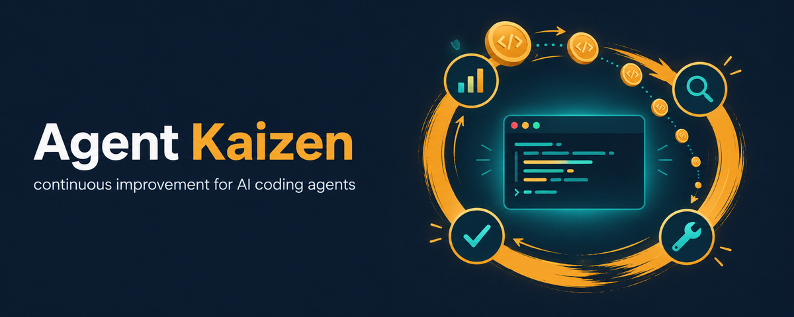

<p align="center"></p>

# Agent Kaizen

[](https://github.com/HighwayofLife/agent-kaizen/actions/workflows/ci.yml) [](LICENSE)

*Kaizen* (改善) is the practice of continuous improvement through small, measured changes. **Agent Kaizen** is a Claude Code plugin for a **self-improving AI development workflow**. It regularly measures how your agents spend tokens, turns and time, makes small targeted changes, checks whether each one paid off, and keeps looking for better tools, settings and models.

It was built while developing a game with Claude Code coordinating Claude subagents and the OpenAI Codex CLI. It works for any project, with or without Codex.

<p align="center">
  <picture>
    <source media="(prefers-reduced-motion: reduce)" srcset="assets/teaser.png">
    
  </picture>
</p>

## Why I built this

I've been building a Colonization-inspired colonial-era game with Claude Code doing the coordinating and handing work off to Codex and other Claude agents. It worked. It also got expensive. And in my own experience I ran out of usage within an hour of each 5h reset.

So I wrote a script to go through my own session logs and found some very disturbing results.

My main sessions were regularly sitting at 450-560k tokens of context, and every single turn re-sends all of that. I had a little "wrapper" agent whose whole job was to run Codex and pass the answer back, and I'd spawned it about 150 times at roughly 80k tokens a pop. My planning agents were averaging around 190 tool calls each, just grepping and reading their way around the codebase. Screenshots I'd passed in once for analysis were stuck in context for the rest of the session. One set of research agents had re-downloaded the same handful of web pages almost 400 times.

None of the fixes were clever:
- compact the session earlier;
- swap the wrapper agent for a plain script;
- build a small symbol index so agents find code in one query instead of fifty;
- a hook that stops agents from reading entire 600-line files unless they really mean it;
- give each subagent a ten-line brief instead of my whole CLAUDE.md;
- turn off MCP connectors I never use in that project.

The problem is that this stuff drifts. New habits creep back in, Claude Code ships a feature that makes one of my workarounds pointless, a cheaper model comes out. A one-time cleanup doesn't stick.

So I turned it into a loop and packaged it as a Claude Code plugin. I called it Agent Kaizen, after the idea of continuous improvement through small changes.

The audit runs every few days on its own (it's just a script, so it costs nothing). When there's a new one, Claude reviews it against a ledger of what I've already changed, proposes the next couple of fixes, and after the next audit we check whether they actually helped. If a change didn't move the numbers, it gets reverted. That ledger has been the most useful part. A few things I was sure would help barely did anything.

There's also a roster step. It figures out which AI tools you pay for, looks up what each one is good at right now, and sets up agents and fallbacks around that. For me, Grok is great for research, Codex for most of the coding, Claude for most of the planning, a Codex model for image analysis, and Gemini gets the giant-document jobs. Yours will be different, so the plugin tailors the agents to what suits your project, and it only sets up what you have.

If you're ready for it, there's a yolo (auto) mode where it applies the changes itself instead of asking you every time. I run it this way. Everything gets backed up and checked first; it rolls back anything that fails, and there's an undo. It still stops and asks before it touches keys, spends money, loosens permissions, deletes anything, or pushes code.

The full list of findings and fixes is in [docs/what-we-learned.md](docs/what-we-learned.md).

## How it works

So this plugin is built as a **loop**:

<p align="center"></p>

1. **Measure:** `scripts/token-audit` runs about every 3 days. It's a plain script, so it costs no tokens. `scripts/usage-series` shows daily usage; `scripts/usage-compare` compares before and after a change. Project outcomes, rules-lint, a drift check and the notes ledger also feed the audit.
2. **Review:** `/agent-kaizen:review` or `/agent-kaizen:cycle` compares the audit with the ledger.
3. **Change one thing** at a time, and log it in `LEDGER.md`.
4. **Re-measure:** the next audit shows whether the change paid off, so you keep, tune or revert it.

Every change gets a row in `docs/kaizen/LEDGER.md` (date, change, why, expected effect, **measured effect**, keep or revert). The next audit fills in the measured effect. Over time the ledger becomes a record of what actually works for *your* setup. Our own results are in [docs/what-we-learned.md](docs/what-we-learned.md).

## Quick start

Requires `jq` and Python 3.9+.

| Tool | Minimum | Tested on |
|---|---|---|
| Claude Code | 2.1.271 (for `omitClaudeMd` subagents) | 2.1.314 |
| Codex CLI (optional) | — | 0.163.0 |
| Python | 3.9 | 3.9 and 3.13 (CI, Linux and macOS) |

Newer versions haven't been tested yet. Setting names and transcript formats change between releases, so if the audit reports zero sessions or a skill's config step fails, check `/agent-kaizen:whats-new` first.

### 1. Install (clone it, then add it as a local plugin)

Cloning gives you a stable path for the scheduled scripts, and `git pull` updates everything.

```bash
git clone https://github.com/HighwayofLife/agent-kaizen.git ~/.claude/agent-kaizen
```

Then, inside Claude Code:

```
/plugin marketplace add ~/.claude/agent-kaizen
/plugin install agent-kaizen@agent-kaizen-tools
```

Or install it straight from GitHub, without a clone:

```
/plugin marketplace add HighwayofLife/agent-kaizen
/plugin install agent-kaizen@agent-kaizen-tools
```

To update: `git pull` in the clone (or `/plugin marketplace update` for a GitHub install), then `/reload-plugins` or start a new session. Releases bump `version` in `plugin.json` (see [CHANGELOG.md](CHANGELOG.md)); a GitHub install only picks up a new version. Re-run `install-schedule --apply` after updating to refresh the scheduled scripts. See the [0.4.0 migration note](docs/scheduling.md#03x-migration).

### 2. Start the loop in a project

Open Claude Code in your project and run:

```
/agent-kaizen:start      # creates docs/kaizen/ (ledger + baseline), suggests next steps
/agent-kaizen:audit      # measures your real usage and ranks the biggest savings
/agent-kaizen:roster     # which AI tools you have, what each is best at, who does what
```

Then run the skills the audit points at. By default each skill **proposes first and waits for your OK** before changing any configuration, and backs up the files it touches.

### Autonomous mode (`yolo`)

If you'd rather not approve every change:

```
/agent-kaizen:autonomy auto       # or: yolo, safe, propose. Saved to agent-kaizen.json in your Claude config dir
/agent-kaizen:cycle yolo          # or for a single run only
```

| Mode | Behaviour |
|---|---|
| `propose` | Default: every change is shown and waits for your OK |
| `safe` | Applies low-risk, reversible changes (docs, instruction cleanups that drop no rule, new scripts, one-row model trials) and proposes the rest |
| `auto` / `yolo` | Applies everything except the hard stops: secrets, spending money or new vendors, loosening permissions, deleting things, commits and pushes, package installs (unless `allowInstalls`) |

In every mode, each applied change is backed up (to `KAIZEN_BACKUP_DIR`, or `kaizen-backups/` under the Claude config dir), verified (`jq`, hook tests, `claude plugin validate`), rolled back automatically if verification fails, and logged in the ledger. At most 3 changes are made per run (`maxChangesPerRun`), so the next audit can tell which change did what. `/agent-kaizen:undo last` (or `run`) reverses changes. Claude Code's own permission prompts still apply: run the session with edits auto-accepted to avoid them. Details: [docs/autonomy.md](docs/autonomy.md).

### 3. Make it periodic

Run `/agent-kaizen:schedule`. It finds the plugin path and asks before it installs anything. Or run `scripts/install-schedule` from the plugin or your clone; the plugin path varies by install.

```bash
scripts/install-schedule --apply                  # audit about every 3 days, no tokens
scripts/install-schedule --apply --review         # weekly review of enrolled projects with activity
scripts/install-schedule --apply --review --auto all  # allow changes in all projects
scripts/install-schedule --apply --review --auto none # propose globally
scripts/install-schedule --apply --review --auto ~/code/my-project # allow changes in this project
```

The plugin's session-start hook tells Claude when a new audit hasn't been reviewed. Then run `/agent-kaizen:cycle`, or ask Claude to use the `kaizen-auditor` agent. See [docs/scheduling.md](docs/scheduling.md).

Running `install-schedule --apply` again without `--review` removes an installed review job. The audit job is not touched.

### Uninstall

1. `scripts/install-schedule --remove` removes the audit and review jobs.
2. `scripts/kaizen-link --unlink` removes the linked scripts and hooks from `<Claude config dir>/bin` (add `--restore-replaced` if you used `--replace`).
3. Remove the plugin: `claude plugin uninstall agent-kaizen@agent-kaizen-tools`.

Project files (`docs/kaizen/`), reports in `<Claude config dir>/audits/` and backups (`KAIZEN_BACKUP_DIR`, or `kaizen-backups/` under the Claude config dir) stay until you delete them.

## Support and environment

| Platform | Scheduler |
|---|---|
| macOS | launchd |
| Linux | cron or systemd user timers |
| Windows | Run the scripts by hand |

| Variable | Used by | Effect |
|---|---|---|
| `CLAUDE_CONFIG_DIR` | Scheduler, audit, hooks | Claude config directory; default `~/.claude` |
| `CODEX_HOME` | Scheduler, audit | Codex data directory; default `~/.codex` |
| `AUDIT_DIR` | Audit notice hook | Overrides notice audit directory; default `<Claude config dir>/audits` |
| `KAIZEN_NOTICE_ALL` | Audit notice hook | `1` enables notices outside enrolled projects; default off |
| `IMAGE_AGENTS` | Image guard | Space-separated agent names; default `image-reader` |
| `ALLOW_IMAGE_READS` | Image guard | `1` disables the guard; default off |
| `READ_GUARD_MAX_LINES` | Read guard | Line limit; default 400 |
| `READ_GUARD_EXTENSIONS` | Read guard | Overrides the exempt extension regex; default is listed in the hook |
| `PLANS_GLOB` | After-compact hook | Plan search glob; default `docs/plans/*/plan.md` |
| `KAIZEN_BACKUP_DIR` | Backup script, scheduler | Backup directory; default `kaizen-backups/` under the Claude config dir |
| `KAIZEN_BASH_BURST` | Bash burst hook | Bash calls per turn between hints; default 8; `0` turns the hook off; a non-numeric value means 8 |
| `CODEX_DISPATCH_MODEL` | `codex-dispatch` | Default for `-m` |
| `CODEX_REVIEW_MODEL` | `codex-review` | Default model for `plan` and `code` reviews |
| `CODEX_LOOK_MODEL` | `codex-review` | Default model for `visual` and `look` reviews |
| `CODEX_DISPATCH_REASON_MODELS` | `codex-dispatch` | Comma-separated model-name tokens that need a reason line in the brief; default `sol`; empty turns the guard off |
| `CODEX_DISPATCH_CHECK_TIMEOUT` | `codex-dispatch` | Seconds before a `-k` check is killed and counted as failed; default 1800; `0` = no limit |
| `CODEX_DISPATCH_CODEX_TIMEOUT` | `codex-dispatch` | Seconds before a Codex run is killed; default 0 = no limit |
| `SESSION_NOTES_TIMEOUT` | Session-notes hook | Seconds allowed for each helper call; default 20 |
| `KAIZEN_SKIP_CHECKS` | Scheduler | `1` skips the drift, rules-lint, notes and project-report steps of a scheduled run |
| `KAIZEN_SESSION_ID` | Backup script | Session id recorded as `session_id` in each backup manifest; the scheduled runner sets it for each run |
| `XDG_CONFIG_HOME` | `install-schedule` | Base directory for systemd user units (`systemd/user` under it); default `~/.config` |
| `KAIZEN_USAGE_DB` | `usage-db` | SQLite file; default `kaizen-usage.db` in the Claude config dir |
| `KAIZEN_REVIEW_MODEL` | Scheduler | Review model; default `sonnet`. Read when you run `install-schedule` (or `kaizen-scheduled` by hand), not by installed jobs |
| `KAIZEN_REVIEW_MAX_TURNS` | Scheduler | Review turn limit; default 40. Read like `KAIZEN_REVIEW_MODEL` |

## Codex dispatch guards

- **Dirty tree:** `codex-dispatch` snapshots the Git tree before it runs and warns if it is dirty.
- **No-change guard:** an engineer run must change files, judged per Codex run. A run that changes nothing counts as a failure and is resumed. `--allow-no-change` turns this off. Planner, `none` and non-Git runs skip it. Ignored files do not count.
- **Reason guard:** if the model name (from `-m` or `CODEX_DISPATCH_MODEL`) contains a token from `CODEX_DISPATCH_REASON_MODELS`, the brief needs a line `<Token> reason: <why>` or `Model reason: <why>` outside code fences. The default token is `sol`, the owner's name for a high-cost Codex tier. Set your own tokens, or an empty value to turn the guard off. Without the line, the script prints a refusal on stdout before it creates `out/`, then `STATUS: CODEX FAILED`, and exits 2. A model chosen only by the Codex config and resumed threads are not checked. The reason is copied into the report.

Flags, timeouts and the report format are in [scripts/README.md](scripts/README.md).

## Skills

All skills are user-triggered (`disable-model-invocation: true`), so their descriptions don't cost context on every turn.

| Skill | What it does | When |
|---|---|---|
| `/agent-kaizen:start` | Ledger, loop README and baseline of what loads every turn | Once per project |
| `/agent-kaizen:audit` | Token, turn and tool usage per session and agent type; ranked savings | First, then every few changes |
| `/agent-kaizen:cycle` | One full loop: audit → review → model and release checks when due → proposals | The default entry point |
| `/agent-kaizen:review` | Fill in measured effects, keep or revert, pick the next 3 changes | When a new audit appears |
| `/agent-kaizen:roster` | Finds the AI subscriptions and CLIs you have, researches each model's strengths, and builds agents, routing, fallbacks and escalation ladders | Once, then when you add or drop a subscription |
| `/agent-kaizen:slim-instructions` | Shrink CLAUDE.md / AGENTS.md into core + topic docs + orchestrator-only import | Big instruction overhead |
| `/agent-kaizen:trim-context` | MCP servers, connectors, plugins, skill and agent descriptions, Codex MCP | Big fixed context in `/context` |
| `/agent-kaizen:lean-agents` | `omitClaudeMd` subagents, role context hook, tools allowlists, model routing table | Costly subagent spawns |
| `/agent-kaizen:codex-dispatch` | Codex by script (checks, resume rounds, 25-line report) instead of wrapper agents | You use Codex |
| `/agent-kaizen:tools-before-tokens` | rg/fd/ast-grep/jq/yq first; scripts for steps agents repeat by hand | Early |
| `/agent-kaizen:code-map` | SQLite symbol index plus `brief` command, so agents find code in one query | Exploration-heavy agents |
| `/agent-kaizen:guardrails` | Hooks: big-read guard, image guard, compaction, all with overrides | After the audit shows the patterns |
| `/agent-kaizen:batch-wakeups` | Swarm lead plus merged reviews, so the main session wakes once | Many small spawns |
| `/agent-kaizen:planning` | Plan dirs, standalone briefs, right-sized planners, exploration budget | Multi-step features |
| `/agent-kaizen:test-loop` | Tiered tests for game/engine projects, engine slots, fast worktrees | Slow test feedback |
| `/agent-kaizen:models` | New Claude and Codex models vs your routing rows, with sources | Monthly |
| `/agent-kaizen:whats-new` | Claude Code and Codex release notes and new CLI tools vs your setup | Monthly |
| `/agent-kaizen:autonomy` | Show or set the mode: `propose` (default), `safe` or `auto` (alias `yolo`) | When you trust the loop |
| `/agent-kaizen:undo` | Reverse the last applied change, a specific one, or a whole run | Any time |
| `/agent-kaizen:schedule` | Install the periodic audit and the optional weekly review | Once the audit works |

Resume rounds re-run only the checks that failed, then all checks once; check commands see `DISPATCH_ROUND` and `DISPATCH_PASS`. Give `-k` the narrowest check (affected/filtered tests); full suites run at the project's batch cadence. A repo may route check commands through an executable `tools/rewrite_check` (argv[1] = the command, stdout = its replacement, empty = unchanged; worktrees fall back to the main checkout's copy).

The plugin also ships a **`kaizen-auditor` agent**, which runs one propose-only cycle and returns a 20-line summary, a **SessionStart hook** for the unreviewed-audit notice, and a Bash burst hook.

## Feeding the audit from your project

Enrol a project with `docs/kaizen/` and record packet outcomes using the [outcome log contract](docs/outcome-log.md). The project report uses those outcomes to propose calibration changes.

## What's in the repo

```
.claude-plugin/     plugin.json + marketplace.json (this repo is its own marketplace)
skills/             the loop, one SKILL.md per step (plain Markdown; readable without the plugin)
agents/             kaizen-auditor (propose-only)
hooks/              audit-notice and bash-burst (enabled by the plugin), plus opt-in guardrails:
                    limit-big-read, block-image-read, subagent-context, after-compact, session-notes
                    (lists running dispatches and dirty worktrees, pending ledger rows and stale rules at session start)
scripts/            token-audit (+ pricing.json), usage-series, usage-compare, usage-db, kaizen-backup (backups + undo), codex-dispatch, codex-run, codex-review,
                    dispatch-status, install-schedule, kaizen-scheduled, kaizen-link, packet-report,
                    kaizen-project-report, rules-lint (+ rules-lint.patterns), notes-ledger
templates/          starting points: global and project CLAUDE.md, orchestrator.md,
                    Codex AGENTS.md and config.toml, settings.example.json,
                    agent templates (scout, judge, swarm-lead, verifier, planner,
                    debugger, image-reader), agent-context role files, plan + brief
docs/               what-we-learned.md, scheduling.md, autonomy.md, outcome-log.md, prompt-evaluation.md
assets/             banner, teaser animation and loop diagram; assets/src/ has the scripts that draw them
```

The guardrail hooks and templates are **opt-in**: `/agent-kaizen:guardrails` and `/agent-kaizen:lean-agents` install and adapt them with your approval. Installing the plugin enables the audit notice and Bash burst hook.

The Bash burst hook counts main-session Bash calls per user turn, failed calls included. Every eight calls by default it adds: "N Bash calls this turn. Chain the remaining steps into one command or script that prints a summary, or hand the investigation to a cheaper read-only subagent." Set `KAIZEN_BASH_BURST` to change the threshold. To turn it off, set `KAIZEN_BASH_BURST=0` or put `"enabled": false` in `agent-kaizen.json` in the Claude config dir.

## Without the plugin

Every skill is a plain Markdown file. You can also point Claude Code at a clone directly:

```
Read ~/.claude/agent-kaizen/skills/audit/SKILL.md and do it for this project.
```

Or paste the `## Task` section of any skill into a session. Where a skill says `${CLAUDE_PLUGIN_ROOT}`, read it as the clone path (for example `~/.claude/agent-kaizen`). Also read the **Autonomy** paragraph above `## Task`.

## Safety

- By default skills propose before they change anything. In `safe`/`auto` mode they apply changes themselves, but always back up first, verify, roll back on failure, log to the ledger, and stop at the hard stops. `/agent-kaizen:undo` reverses any change.
- Scheduled runs default to propose mode: the audit is a plain script, and the weekly review runs with read-only tools and prints its proposal.
- Audits read your local transcripts (`projects/` under the Claude config dir, `sessions/` under the Codex home). Reports stay on your machine under `docs/kaizen/` or `audits/` in the Claude config dir. Don't commit audit reports to a public repo; they can contain file paths and prompt fragments.
- Setting names and CLI flags change between versions. The skills tell Claude to check the current docs before writing config.

## Compared with TokenEconomizer

[TokenEconomizer](https://github.com/microsoft/TokenEconomizer) (Microsoft Research and UC Berkeley, [paper](https://arxiv.org/abs/2610.22732)) has the same goal: make coding agents cheaper by learning from your own sessions. It works inside each session. Its hooks state repository facts learned from earlier sessions, deny tools that keep going unused, and have a Haiku judge redirect turns that are stuck in failure loops. It supports Claude Code, Codex, the Copilot CLI, Pi and opencode, and its paper measures 18–31% lower cost on SWE-Bench tasks.

Agent Kaizen works one level up, on the whole workflow. It covers how the main session routes work across models and vendors, how subagents are spawned and briefed, how much instruction and fixed context loads every turn, and which tools and models you use at all. It changes configuration between sessions, one measured change at a time, and keeps a ledger of what paid off. Its audit also measures TokenEconomizer's three targets, at zero token cost:
- failures that repeat across sessions, which become one-line repo facts;
- unused tools and MCP servers, which become deny rules;
- stuck turns, which lead to fixing the cause.

It turns these into proposals rather than acting live inside a session.

**Don't run both in the same project.** Both add deny rules to `.claude/settings.local.json` and add context at session start. Each one's changes would show up in the other's measurements as unexplained, and the ledger could no longer tell which change did what. To trial TokenEconomizer's loop guard alongside Kaizen, set its `toolprune=propose` and leave `microskills` off, and log the trial as one ledger row.

## Contributing

See [CONTRIBUTING.md](CONTRIBUTING.md). Issues and PRs are welcome, especially ledger results ("this change saved X% in a setup like Y"), new skills, and ports of the scripts to other agent CLIs.

## License

MIT. See [LICENSE](LICENSE). The banner artwork and the plugin icon were generated with OpenAI's image model (gpt-image-2) for this project. The banner title, the teaser animation and the loop diagram are drawn by the scripts in `assets/src/`. All of them are released under the same MIT license.
