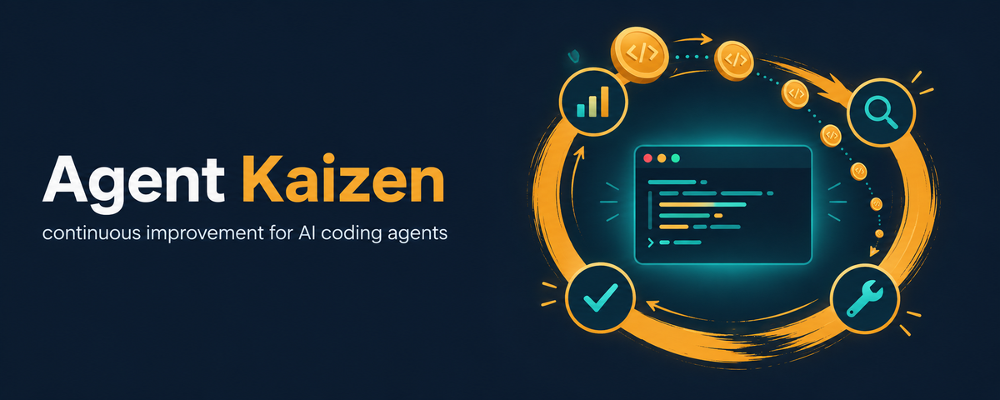
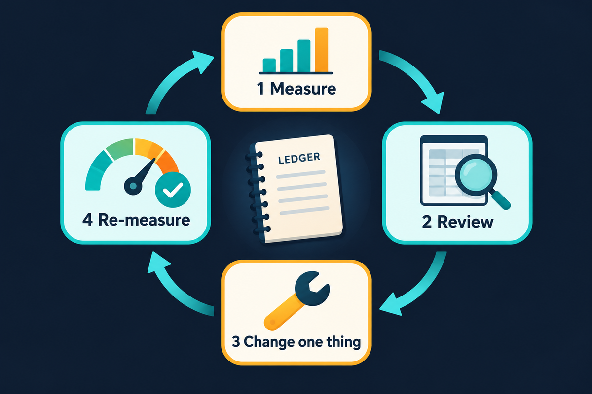

<p align="center"></p>

# Agent Kaizen

*Kaizen* (改善) is the practice of continuous improvement through small, measured changes. **Agent Kaizen** is a Claude Code plugin for a **self-improving AI development workflow**. It regularly measures how your agents spend tokens, turns and time, makes small targeted changes, checks whether each one paid off, and keeps looking for better tools, settings and models.

It was built while developing a game with Claude Code coordinating Claude subagents and the OpenAI Codex CLI. It works for any project, with or without Codex.

## Why

Agentic coding gets expensive in ways that are hard to see from inside a session:
- A main session re-sends its whole context every turn, so 500k context × 100 turns adds up quickly.
- Subagents that load the entire `CLAUDE.md` to run a single grep.
- Wrapper agents that spend a full context just relaying another tool's output.
- Planners that explore with hundreds of grep-and-read calls.
- Images and whole files that sit in context for the rest of a session.
- MCP tools and connectors that load on every turn and are never used.

One-off tune-ups decay: new habits creep in, new features ship, new models appear. So this plugin is built as a **loop**:

<p align="center"></p>

1. **Measure:** `scripts/token-audit` runs every 3 days. It's a plain script, so it costs no tokens.
2. **Review:** `/agent-kaizen:review` or `/agent-kaizen:cycle` compares the audit with the ledger.
3. **Change one thing** at a time, and log it in `LEDGER.md`.
4. **Re-measure:** the next audit shows whether the change paid off, so you keep, tune or revert it.

Every change gets a row in `docs/kaizen/LEDGER.md` (date, change, why, expected effect, **measured effect**, keep or revert). The next audit fills in the measured effect. Over time the ledger becomes a record of what actually works for *your* setup. Our own results are in [docs/what-we-learned.md](docs/what-we-learned.md).

## Quick start

Requires Claude Code 2.1.271 or newer (for `omitClaudeMd` subagents), `jq`, and Python 3.9+.

### 1. Install (clone it, then add it as a local plugin)

Cloning gives you a stable path for the scheduled scripts, and `git pull` updates everything.

```bash
git clone https://github.com/HighwayofLife/agent-kaizen.git ~/.claude/agent-kaizen
```

Then, inside Claude Code:

```
/plugin marketplace add ~/.claude/agent-kaizen
/plugin install agent-kaizen@agent-kaizen-tools
```

Or install it straight from GitHub, without a clone:

```
/plugin marketplace add HighwayofLife/agent-kaizen
/plugin install agent-kaizen@agent-kaizen-tools
```

To update: `git pull` in the clone (or `/plugin marketplace update` for a GitHub install), then `/reload-plugins` or start a new session. Releases bump `version` in `plugin.json` (see [CHANGELOG.md](CHANGELOG.md)); a GitHub install only picks up a new version. Re-run `install-schedule --apply` after updating to refresh the scheduled copy of `token-audit`.

### 2. Start the loop in a project

Open Claude Code in your project and run:

```
/agent-kaizen:start      # creates docs/kaizen/ (ledger + baseline), suggests next steps
/agent-kaizen:audit      # measures your real usage and ranks the biggest savings
/agent-kaizen:roster     # which AI tools you have, what each is best at, who does what
```

Then run the skills the audit points at. Each skill **proposes first and waits for your OK** before changing any configuration, and backs up the files it touches.

### 3. Make it periodic

```bash
~/.claude/agent-kaizen/scripts/install-schedule --apply            # usage audit every 3 days (no tokens)
~/.claude/agent-kaizen/scripts/install-schedule --apply --review --project-dir ~/code/my-project
#   + weekly propose-only review in that project (Sonnet, max 40 turns, read-only tools)
```

The plugin's session-start hook tells Claude when a new audit hasn't been reviewed. Then run `/agent-kaizen:cycle`, or ask Claude to use the `kaizen-auditor` agent. See [docs/scheduling.md](docs/scheduling.md).

## Skills

All skills are user-triggered (`disable-model-invocation: true`), so their descriptions don't cost context on every turn.

| Skill | What it does | When |
|---|---|---|
| `/agent-kaizen:start` | Ledger, loop README and baseline of what loads every turn | Once per project |
| `/agent-kaizen:audit` | Token, turn and tool usage per session and agent type; ranked savings | First, then every few changes |
| `/agent-kaizen:cycle` | One full loop: audit → review → model and release checks when due → proposals | The default entry point |
| `/agent-kaizen:review` | Fill in measured effects, keep or revert, pick the next 3 changes | When a new audit appears |
| `/agent-kaizen:roster` | Finds the AI subscriptions and CLIs you have, researches each model's strengths, and builds agents, routing, fallbacks and escalation ladders | Once, then when you add or drop a subscription |
| `/agent-kaizen:slim-instructions` | Shrink CLAUDE.md / AGENTS.md into core + topic docs + orchestrator-only import | Big instruction overhead |
| `/agent-kaizen:trim-context` | MCP servers, connectors, plugins, skill and agent descriptions, Codex MCP | Big fixed context in `/context` |
| `/agent-kaizen:lean-agents` | `omitClaudeMd` subagents, role context hook, tools allowlists, model routing table | Costly subagent spawns |
| `/agent-kaizen:codex-dispatch` | Codex by script (checks, resume rounds, 25-line report) instead of wrapper agents | You use Codex |
| `/agent-kaizen:tools-before-tokens` | rg/fd/ast-grep/jq/yq first; scripts for steps agents repeat by hand | Early |
| `/agent-kaizen:code-map` | SQLite symbol index plus `brief` command, so agents find code in one query | Exploration-heavy agents |
| `/agent-kaizen:guardrails` | Hooks: big-read guard, image guard, compaction, all with overrides | After the audit shows the patterns |
| `/agent-kaizen:batch-wakeups` | Swarm lead plus merged reviews, so the main session wakes once | Many small spawns |
| `/agent-kaizen:planning` | Plan dirs, standalone briefs, right-sized planners, exploration budget | Multi-step features |
| `/agent-kaizen:test-loop` | Tiered tests for game/engine projects, engine slots, fast worktrees | Slow test feedback |
| `/agent-kaizen:models` | New Claude and Codex models vs your routing rows, with sources | Monthly |
| `/agent-kaizen:whats-new` | Claude Code and Codex release notes and new CLI tools vs your setup | Monthly |
| `/agent-kaizen:schedule` | Install the periodic audit and the optional weekly review | Once the audit works |

The plugin also ships an **`kaizen-auditor` agent**, which runs one propose-only cycle and returns a 20-line summary, and a **SessionStart hook** for the unreviewed-audit notice.

## What's in the repo

```
.claude-plugin/     plugin.json + marketplace.json (this repo is its own marketplace)
skills/             the loop, one SKILL.md per step (plain Markdown; readable without the plugin)
agents/             kaizen-auditor (propose-only)
hooks/              audit-notice (enabled by the plugin), plus opt-in guardrails:
                    limit-big-read, block-image-read, subagent-context, after-compact
scripts/            token-audit, codex-dispatch, codex-review, dispatch-status, install-schedule
templates/          starting points: global and project CLAUDE.md, orchestrator.md,
                    Codex AGENTS.md and config.toml, settings.example.json,
                    agent templates (scout, judge, swarm-lead, verifier, planner,
                    debugger, image-reader), agent-context role files, plan + brief
docs/               what-we-learned.md, scheduling.md, prompt-evaluation.md
```

The guardrail hooks and templates are **opt-in**: `/agent-kaizen:guardrails` and `/agent-kaizen:lean-agents` install and adapt them with your approval. Installing the plugin enables only the audit notice.

## Without the plugin

Every skill is a plain Markdown file. You can also point Claude Code at a clone directly:

```
Read ~/.claude/agent-kaizen/skills/audit/SKILL.md and do it for this project.
```

Or paste the `## Task` section of any skill into a session.

## Safety

- Skills propose before they change anything, back up config first, and log every change in the ledger.
- Scheduled runs are propose-only: the audit is a plain script, and the weekly review runs with read-only tools and prints its proposal.
- Audits read your local transcripts (`~/.claude/projects`, `~/.codex/sessions`). Reports stay on your machine under `docs/kaizen/` or `~/.claude/audits/`. Don't commit audit reports to a public repo; they can contain file paths and prompt fragments.
- Setting names and CLI flags change between versions. The skills tell Claude to check the current docs before writing config.

## Contributing

See [CONTRIBUTING.md](CONTRIBUTING.md). Issues and PRs are welcome, especially ledger results ("this change saved X% in a setup like Y"), new skills, and ports of the scripts to other agent CLIs.

## License

MIT. See [LICENSE](LICENSE). The images in `assets/` and the plugin icon were generated with OpenAI gpt-image-2 for this project and are released under the same MIT license.
