# Executive summary

**The problem.** A solo developer used Claude Code as an orchestrator over Claude, Codex, Grok and Gemini agents to build a Colonization-inspired colonial-era strategy game. The setup worked, but the 5-hour usage window ran out within an hour of each reset. A plain script over the developer's own session logs (no model, zero tokens) showed where the tokens went.

**The core insight.** Cost is roughly context times turns. Every turn re-sends the whole conversation, and every agent that finishes wakes the orchestrator for another full-context turn. Main sessions sat at 450k-560k tokens, so each wake-up re-sent about half a million tokens.

**What we changed.** None of the fixes were clever: compact earlier; replace a "wrapper" agent with a script; keep images and whole files out of the orchestrator; give subagents a ten-line brief instead of the full rules file; batch completions; cache web fetches; build a small symbol index; route by tier and vendor, and cap the most expensive model.

**What we measured.** A clean before/after split (about 6 active days before, 2.8 days after, several changes landing together) shows:

| Measure | Before | After | Change |
|---|---|---|---|
| Orchestrator context per call | 479k | 164k | −66% |
| Context per orchestrator wake-up | 521k | 170k | −67% |
| Images in orchestrator context, per active day | about 28 | 0 | gone |
| Codex wrapper-agent spawns per day | about 64 | about 9 | −86% |
| API-equivalent Claude cost per active day | $304 | $175 | −42% |
| API-equivalent cost per main call (Claude + Codex) | $0.43 | $0.22 | −48% |
| API-equivalent total cost per active day (Claude + Codex) | $386 | $390 | flat |
| Tokens per commit (Claude + Codex) | 6.7M | 5.3M | −21% |

The orchestrator made about 1.7 times as many main calls per day after the changes (1,009 to 1,741). Claude spend per active day fell 42%. Total spend stayed flat because bulk coding moved to Codex, which has no 5-hour window: its token volume per day rose 3.2 times while commits per active day went from 200 to 234. The cost rows use active days (50 or more main calls); the Codex and total rows use only the days with Codex logs.

**Weeks three and four (to 2026-11-17).** The loop kept running on the same setup. Several more things were measured, each with its own window and a mixed result:

| Measure | Before | After | Reading |
|---|---|---|---|
| Verifier spawns per merge (risk-tagged batch review) | 1.37 | 0.40 | down; whether batch review catches what per-packet review did is not yet verified |
| Sol engineer sessions (Terra as the coding default) | 144 (Oct 30 to Nov 2) | 0 in 14 days to Nov 17 | down, but the Codex lane also ended about Nov 6 |
| Orchestrator turns triggered by tool results, per merge | 40 | 24.6 | down 39% |
| Merges since the last green full batch | 66 | 38 | better, still over the threshold of 20 |
| Slot-wait p90 for Unity checks | 2,903 s | 4,592 s over 14 days | worse on peak days, better at normal load |

The orchestrator's average context stayed at 109k to 132k per call after compaction moved to 180k. What got worse: engineering drifted from Codex to Claude, and the most expensive engineer, opus-engineer, took 26% of 14-day spend. The batch-review catch rate, the packet outcome log and the full-batch trigger all have gaps. Section 7 has the detail, and the proposals from the 2026-11-17 cycle are recorded as proposals, not results.

**What did not help.** A tool-call budget for planning agents did not reduce exploration (median calls rose from 93 to 116). The symbol index reached only 2.9% of code searches in the clean split. A "swarm lead" agent added to cut wake-ups became a large new cost of its own.

**The money.** The subscriptions are flat, so no bill went down; the gain is headroom under the usage limits. Dollar figures are API list prices used as a weighting, not a bill.

**Top lessons.**

1. Measure before changing anything. A zero-token audit of your own logs is cheap and specific.
2. Shrink what the orchestrator re-sends. That was the largest measured win.
3. A sub-agent whose only job is to run another tool should be a script, not an agent.
4. A rule an agent never sees does not help. Put rules where agents load them.
5. Change one thing at a time, log it, re-measure, and revert what does not move the numbers.

**Who this is for.** Developers, tech leads and engineering managers running AI coding agents. The numbers come from one setup over a short window. The method transfers; the roster does not.


*Figure 1. Less context per turn; exploration still needs work. Less context and fewer wrappers; planner exploration and codemap uptake remain open issues.*

# 1. The problem

> **Key takeaway:** The setup did not fail because a model was too expensive. It failed because a large context was re-sent on thousands of turns.

## 1.1 The setup

The project was a Colonization-inspired colonial-era strategy game, built in Unity. One person ran it with a team of AI agents:

- **One orchestrator.** The main Claude Code session planned, delegated, verified and integrated. From 2026-10-19 it ran on Opus 5.5 at `high` effort.
- **Many subagents.** Claude agents (Haiku, Sonnet, Opus and, rarely, Fable) for planning, review and judging. Codex models (Sol, Terra, Astra, Luna) for most coding and visual work. Grok for research and tie-break reviews. Gemini for very long documents.
- **Lots of parallel work.** Work ran in many parallel git worktrees. One session week had 451 merge commits. The owner had asked for maximum parallelism and for agents to keep going without prompting.

It worked. It also ran out of usage within an hour of each 5-hour reset.

## 1.2 An earlier warning: the Fable week

Before any audit existed there was a warning sign. One orchestrator session running on Fable 5.1, the top Claude model, made 2,159 calls at an average context of 458k tokens (peak 967k). That is about 1B tokens. It exhausted the weekly Fable allowance. Fable subagents used 6M tokens that same week.

The subagents were not the problem. The orchestrator was: a big context, times many calls, on the most expensive model. On 2026-10-19 the orchestrator moved to Opus 5.5 at `high` effort and Fable got a cap (section 4.11).

## 1.3 The first audit

On the evening of 2026-10-27 David wrote a script to go through his own session logs. The first token audit covered activity from 2026-10-25 and found 28,133 Claude calls, 4.36B context tokens, 15.2M output tokens and 319 Codex sessions. The findings, in the words of the launch post:

> "My main sessions were regularly sitting at 450-560k tokens of context, and every single turn re-sends all of that. I had a little 'wrapper' agent whose whole job was to run Codex and pass the answer back, and I'd spawned it about 150 times at roughly 80k tokens a pop. My planning agents were averaging around 190 tool calls each, just grepping and reading their way around the codebase. Screenshots I'd passed in once for analysis were stuck in context for the rest of the session. One set of research agents had re-downloaded the same handful of web pages almost 400 times."

Most of the fixes landed on 2026-10-27 and 2026-10-28. On 2026-10-29 the loop was packaged as Agent Kaizen, an open-source Claude Code plugin. On 2026-10-30 the first clean before/after measurement was taken.


*Figure 2. The setup changed in several steps. Most context-saving changes landed on Oct 27–28; the first clean split followed Oct 30.*

## 1.4 The core insight: cost is context times turns

Every turn of a Claude Code session re-sends everything the model needs to continue:

- the system prompt, the always-loaded rules files (CLAUDE.md and anything it imports) and tool schemas;
- the whole conversation so far;
- anything read into the conversation and not compacted away: whole files, logs, images.

So the cost of a session is roughly **context × turns**. A 500k context re-sent 2,000 times is a billion tokens, however short each reply is.

The second half of the insight is about agents. **Every agent completion wakes the orchestrator.** When a background agent finishes, the main session gets a new turn, and that turn re-sends the main session's full context. Spawning 150 small agents means 150 full-context orchestrator turns, on top of whatever the agents themselves cost. The orchestrator's model and effort setting are paid on every one of those turns.

Most of this is cache read, which is billed at a small fraction of fresh input. In the audits, 91-98% of context tokens were cache reads. So raw token counts overstate cost. The audit tool therefore also reports an API-equivalent cost that weights each token kind by its list price. Even after that weighting, cache reads were the largest component: 48.8% of API-equivalent cost in the later audit, against 16.3% for output.

Everything in section 4 does one of two things: it shrinks what is re-sent each turn, or it cuts the number of turns.

# 2. How we measured

> **Key takeaway:** The measuring costs nothing because it is a script, not a model. The hard part is choosing windows that compare like with like.

## 2.1 A zero-token audit

Claude Code and the Codex CLI keep session transcripts on the local disk. The audit (`token-audit`, now part of Agent Kaizen) is a standard-library Python script that reads them. It never calls a model, so it costs no tokens and can run every few days on a schedule.

It reports:

- **Main sessions:** turns, peak and median context, tokens by kind.
- **Per subagent type:** spawns, median and 90th-percentile tool calls, median context, total tokens, brief sizes.
- **Per tool:** counts, top shell commands by first word, largest files read whole, images read, URLs fetched more than once.
- **Waste patterns:** sessions that never compact, wrapper agents, exploration loops, whole-file reads, long-running planners, many small spawns.
- **API-equivalent cost** by agent type and model, from a hand-maintained table of published list prices.
- **Stuck turns** (the same failure three or more times in one turn), repeated failures across sessions, and unused tools and MCP servers.

Duplicate message ids count once. The first version of the audit was a prompt asking Claude to read transcripts. Transcripts are huge and the prompt could double-count tokens, which is why it became a script.

## 2.2 The clean before/after split

Early audits had different windows, so their numbers could not be compared directly. For the 2026-10-30 measurement we built a clean split around a cutoff of 2026-10-28 00:00 UTC:

- **Before:** transcript files last written before the cutoff, from 2026-10-20 on. Activity runs 2026-10-20 to 2026-10-27: 6 active days (no activity on 10-24 and 10-25; 10-23 had only 5 calls). Using whole files means no session from after the cutoff leaks in.
- **After:** everything since the cutoff, about 2.8 days to 2026-10-30.

Rules for reading it:

- The windows differ in length and in the work done. **Compare rates, ratios and per-call numbers, not totals.**
- Image, `Read` and spawn counts are for the main session. Search and fetch counts are for subagent shell commands.
- Several changes landed together. The split shows their **combined** effect. It does not say which fix saved what.

## 2.3 Cost: a separate, stricter window

The cost figures come from a per-day series built from the same transcripts (`data/daily.csv`), priced with the plugin's `pricing.json` (API list prices, checked 2026-10-29). Whole UTC days are used, and a day counts as active when it has at least 50 orchestrator calls. Under that rule the before window has 5 active days, not 6, because 10-23 had only 5 calls.

Two limits apply:

- **Codex logs before 2026-10-26 are gone.** Claude numbers cover all 5 before days. Anything that prices Codex compares 10-26..10-27 (2 days) with 10-28..10-30 (3 days). Codex token volume comes from its state database, which covers every day.
- **The cost section was corrected twice on 2026-10-31.** The first version counted Codex sessions from after the change in the before window. The second correction fixed a double count: the prototype script that built the per-day series counted every transcript row with usage as one API call, but Claude Code writes several rows per message, each repeating the same usage. Calls and dollar costs were about 1.8 times too high. The series is rebuilt with the published, de-duplicating scripts (section 11 and Appendix C). This paper uses only the corrected figures. The context, wake-up, image, wrapper and fetch numbers came from `token-audit`, which de-duplicates, and did not change.

## 2.4 What the data cannot tell you

- **Commits are a rough unit of work.** The after window had a different workload and about 1.7 times the main calls per day. "Per orchestrator call" is a proxy, not "per feature shipped". Per-commit figures (section 6) help, but commit sizes vary and some days have big asset or generated-file commits.
- **The windows are short.** Days, not weeks.
- **Prices are approximate.** Cache writes are priced at the 5-minute rate, and Haiku's higher price for prompts over 100k is ignored. Both understate slightly. Models with no price entry count as zero.
- **The analysis has its own cost.** The audit is free, but the sessions spent reviewing audits and building fixes were not separated out.

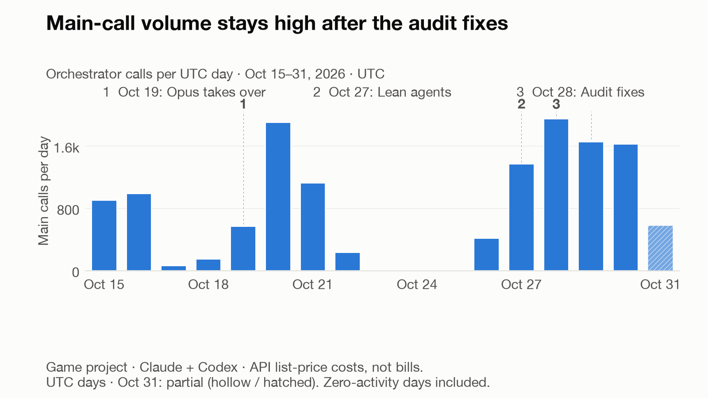

*Figure 3. Main-call volume stays high after the audit fixes. Lower per-call costs coexist with high call volume; this is not a measure of output quality.*

# 3. Where the tokens went

> **Key takeaway:** The waste was not in any single agent. It was in what the orchestrator carried and how often it was woken.

The audits found seven patterns. Numbers here come from the first audit (window from 2026-10-25), a later audit (window from 2026-10-23) and a seven-day usage audit (2026-10-22 to 2026-10-29). Their windows differ, so they describe the problem; they are not a before/after.

| Pattern | What the audit saw |
|---|---|
| Huge orchestrator context | Main sessions at 450k-560k average context. The largest: 2,937 calls at 564k average, peak 967k. |
| Wake-ups at full context | 361 task-notification turns averaging 558k context in the first audit. In the seven-day audit, the largest session's 492 background launches each woke the orchestrator later. |
| Wrapper agents | 146 spawns of a Codex wrapper at about 80k context each (398M context). With its 3D sibling, 171 spawns and about 535M context. About 86% of their tool calls were shell commands. |
| Exploring planners | `opus-planner`: median 194 tool calls per spawn (max 252), 216k average context, two spawns running over 160 minutes. Top commands: `grep -n`, `sed -n`, `grep -rn`. |
| Images stuck in context | 67 image blocks read into the main session, each re-sent on every later turn. |
| Repeated web fetches | 391 raw `curl` calls by per-item judges. One page fetched 28 times, several 19-25 times. One 793k-character claims file was read whole by 33 judges. |
| Whole-file reads | About 19M characters of `Read` results in the main session. Plan files of 52k-182k characters were read whole 4-10 times. |

The later audit added an API-equivalent cost view. Over its window, total cost was $1,553 at list prices. The main session alone was $505, second only to all of Codex at $623. By component: cache read 48.8%, cache write 21.7%, output 16.3%, uncached input 13.2%.

Two things did not show up as problems: search-and-read loops were short (median run 1-3, max 7), and Codex sessions stayed under 200 shell commands each.

# 4. What we changed

> **Key takeaway:** Every fix either shrinks what is re-sent each turn or cuts the number of turns. Most are configuration, a hook or a short script.

Each subsection gives the problem, the change, and what was measured. Results are from the clean split unless stated. Because the changes landed together, a result next to a fix is consistent with that fix, not proof that it alone caused it.

## 4.1 Compact earlier

**Problem.** Main sessions grew to 450k-560k tokens and peaked at 967k. Every turn paid for all of it.

**Change.** Auto-compaction for the Opus orchestrator was set to 400k on 2026-10-27 and lowered to 250k after the token audit. A `SessionStart` hook with the `compact` matcher runs after each compaction and prints a short note: the branch and recent commits, uncommitted changes, worktrees, the most recently changed plan files, and a reminder that background agents may still be running. A compacted summary is lossy, so the rule is that state lives in files (`plan.md`, brief files), not in the conversation. At a plan boundary the orchestrator updates `plan.md` and suggests a good point to compact or start fresh.

```json
"modelSettings": {
  "claude-opus-5-5": { "effortLevel": "high", "autoCompactWindow": 250000 }
}
```

**Result.** Peak context fell from 967k to 367k overall. The three sessions that peaked at 363k-367k all started before the 250k change landed, when the cap was still 400k. Every session started after it peaked at or below 217k. In David's words on the launch thread: "due to many other changes, we almost never hit this context limit". That is his experience, not a ledger number.

**Caveat.** Compacting invalidates the prompt cache, as do connecting or disconnecting MCP servers and switching models. Make such changes between sessions where you can.

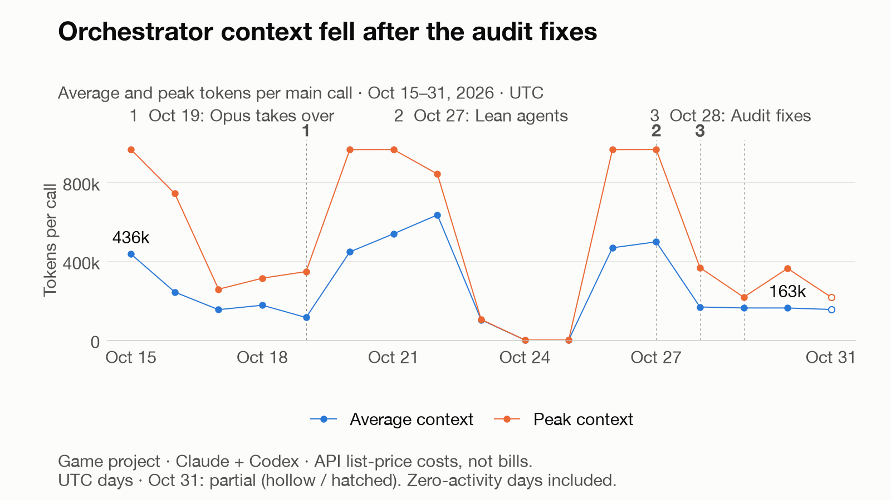

*Figure 4. Orchestrator context fell after the audit fixes. The daily average settles near 164k tokens after Oct 28.*

## 4.2 Lean subagent context

**Problem.** Every subagent that loads the full rules file pays for it on every one of its turns. With dozens of agent types and hundreds of spawns a day, that adds up.

**Change.** Three parts:

1. **Skip the big rules file.** Custom agents set `omitClaudeMd: true`. A `SubagentStart` hook injects about 10 lines of shared rules (`common.md`) plus one role file (coding, planning, review or research). Built-in agents such as general-purpose still load everything, so the orchestrator prefers custom agents.
2. **Split the main rules file three ways:** a short core with the rules nearly every task needs, topic docs that agents read only when the task matches, and an orchestrator-only file that subagents and Codex never load. Dated stories ("why we decided this") moved to a separate rationale file; the rule itself stays one line.
3. **Do not inherit the expensive model.** `CLAUDE_CODE_SUBAGENT_MODEL=sonnet`, so ad-hoc spawns do not run on the orchestrator's Opus.

Every brief stands alone: goal and why, acceptance criteria, relevant files, scope limits, exact verify commands, and the code-map command where the repo has one. A subagent starts with no conversation history; the brief is everything it has.

**Result.** Not measured on its own. It is part of the combined drop in orchestrator and wake-up context, and the ledger lists it as pending.

**Catch.** A rule an agent never sees does not help. The code-map rule lived in the main rules file, which the lean subagents no longer loaded (section 4.7).

## 4.3 Dispatch scripts instead of wrapper agents: sub-agents as executables

This is the change David considers the biggest advance in the setup, so it gets the most space.

**Problem.** Codex did most of the coding, and it was reached through small Claude agents (`codex-engineer`, `codex-3d-engineer`, `codex-reviewer`). They ran on Haiku at low effort. Each took a brief, wrote it to a file, ran `codex exec`, tailed the logs, ran checks, and relayed the answer. The top shell commands of the wrapper were `cat >` (146), `tail -c` (125) and `grep -n` (102): writing the brief and tailing logs.

That looks cheap: Haiku, low effort. It was not. Each spawn carried a full agent context of about 80k tokens on average. 171 spawns of the two engineer wrappers cost about 535M context. And every one of those spawns ended with a full-context wake-up of the orchestrator.

**The idea.** A sub-agent is a model process with its own context window. When its only job is "run a command, wait, relay the answer", that context is pure overhead. A script can do the same job with no model in the middle. **The script is the sub-agent**: it takes a brief, does bounded work, and returns a short, parseable report plus an exit code. The orchestrator sees only the report.

```
BEFORE (wrapper agent)
  orchestrator --spawn--> Haiku wrapper agent (~80k context, ~30 tool calls)
                             |-- writes brief file (cat >)
                             |-- runs codex exec, tails logs (tail -c, grep -n)
                             |-- runs checks, re-runs, reads output
                             '-- relays answer
  orchestrator <--notification-- wrapper finishes (full-context wake-up)

AFTER (script)
  orchestrator --run in background--> codex-dispatch -k 'make test' BRIEF.md
                                         |-- Codex edits files (sandboxed)
                                         |-- checks run on the host
                                         |-- failing checks -> resume same Codex thread
                                         '-- report (<= 25 lines) + logs on disk
  orchestrator <--notification-- one wake-up, reads ~25 lines, opens logs only on failure
```

**What `codex-dispatch` does.**

1. Assembles the final brief: a short role preamble (engineer, planner, 3D), the code locations the brief names (from the code map, if the repo has one), then the task.
2. Runs Codex in a workspace-write sandbox. Unrequested MCP servers, plugins and memory are switched off for the run, so their tool lists do not load.
3. Runs every check command (`-k`) on the host, outside the sandbox, and decides pass or fail from exit codes. No model judges whether tests passed.
4. If a check fails, resumes the same Codex thread with only the relevant failing lines (error lines plus the tail, capped), up to 2 rounds. Since plugin 0.3.1, resume rounds re-run only the failing checks, then confirm the rest once.
5. Prints a report of at most 25 lines ending in `STATUS:` and exits with a code the caller can branch on: 0 DONE, 1 CHECKS FAILING, 2 CODEX FAILED. Full logs go to a per-run directory on disk.

An illustrative report (layout from the code, values invented):

```
Model/effort: gpt-6.1-sol / medium
Code map: 6 location lines
Codex: <up to 10 lines of Codex's own summary>
Diff: <git diff --stat, trimmed>
Check 1 PASS: make lint
Check 2 PASS: make test
Rounds used: 1/2 resumes
OUTDIR: out/dispatch/<stamp>-add-sort
STATUS: DONE
```

Reviews work the same way. `codex-review diff|plan|visual|look` runs Codex read-only and returns a capped report with a strict `VERDICT:` line that the script validates. If the model ignores the format, the script reports a failure instead of passing prose through.

**The orchestrator's habits change too.** Launch the script as a background command. Keep working. Wait for the completion notification instead of polling (each poll is another full-context turn). Read the report only. Open the logs only when the status is bad.

**Why it saves so much.** Three costs go down at once: the wrapper's own context, the orchestrator's reading (25 lines instead of a relay transcript), and, through better batching, wake-ups. The script still produces one notification when it finishes, but the report is small and no agent transcript is involved. And because the work runs on a different vendor's model, it does not use Claude usage at all.

**Result.** `codex-engineer` wrapper spawns fell from about 64 to about 9 per day (−86%). The remaining spawns are a deliberate fallback: thin Haiku agents kept for cases that really need an isolated agent context.

```yaml
name: codex-engineer
model: haiku
effort: low
tools: Bash, Write
omitClaudeMd: true
# Fallback only: map the brief to one codex-dispatch call and return its report verbatim.
```

**Design rules that made it work.** From how the scripts are written:

- **Bounded output.** A hard line cap, enforced in code; the variable parts shrink first. The caller's context cost becomes a constant.
- **Logs to disk.** The report prints the log path. The caller reads logs only on failure.
- **Deterministic checks inside the loop**, on the host.
- **Resume instead of restart**, with only the failing lines, and a cap on rounds.
- **Exit codes and a status line** the caller can branch on without reading anything.
- **Run in the background.** The script is simple and synchronous; the caller backgrounds it, so nobody polls.
- **A preamble per role, as a file**, carrying standing rules so briefs stay short.
- **Handle the flaky parts in the script:** overload backoff, a lost thread id, an empty final message. Each is a named failure with a reason line.
- **Turn off what the run does not need.** Every MCP server loads its tool list into every run.

The pattern is not specific to Codex. Any agent CLI that can take a prompt non-interactively can be wrapped this way. In this setup Grok and Gemini are still reached through thin agents, because no script was written for them yet.

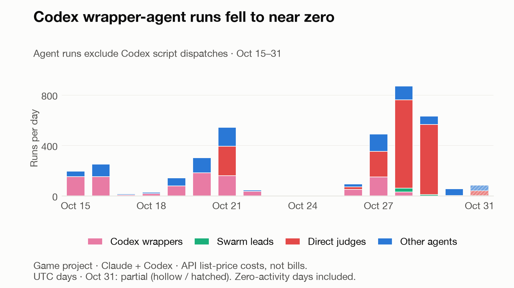

*Figure 5. Codex wrapper-agent runs fell to near zero. Wrapper runs collapse after Oct 27; the timeline records script dispatch becoming the normal route.*

## 4.4 Keep images out of the orchestrator

**Problem.** Screenshots passed in once for analysis stayed in context for the rest of the session and were re-sent every turn. The first audit counted 67 image blocks in the main session.

**Change.** A `PreToolUse` hook on `Read` denies image files unless the calling agent is a designated image agent. The hook input carries the agent type, and the main session has none, which is how the hook knows it is the orchestrator. The deny message says what to do instead: send the question to an image-reading agent or a review script (`codex-review look`), or use `magick identify` / `magick compare` for sizes, formats and pixel diffs. An environment variable overrides it.

**Result.** Images in main-session context went from 166 in the before window (about 28 per active day) to 0.

## 4.5 Guard whole-file reads

**Problem.** A whole-file read of a 600-line file stays in context for the rest of the session. The orchestrator also re-read large plan files whole several times.

**Change.** A second `PreToolUse` hook on `Read` denies reads without a line range for files over 400 lines (code, data, config and log extensions). The deny message suggests `rg -n PATTERN file` and spells out the override: re-read with an explicit `limit`. The first version had no override, and agents that really needed the whole file got stuck. Every guard now states its override in the deny message.

A related rule: long command output goes to a file and is read with `tail` or `rg`, never whole. The orchestrator does not read big files or logs itself; a scout agent or a script does.

**Result.** Main-session `Read` results fell from about 30 to about 10 per day. The split does not isolate the hook from the other changes.

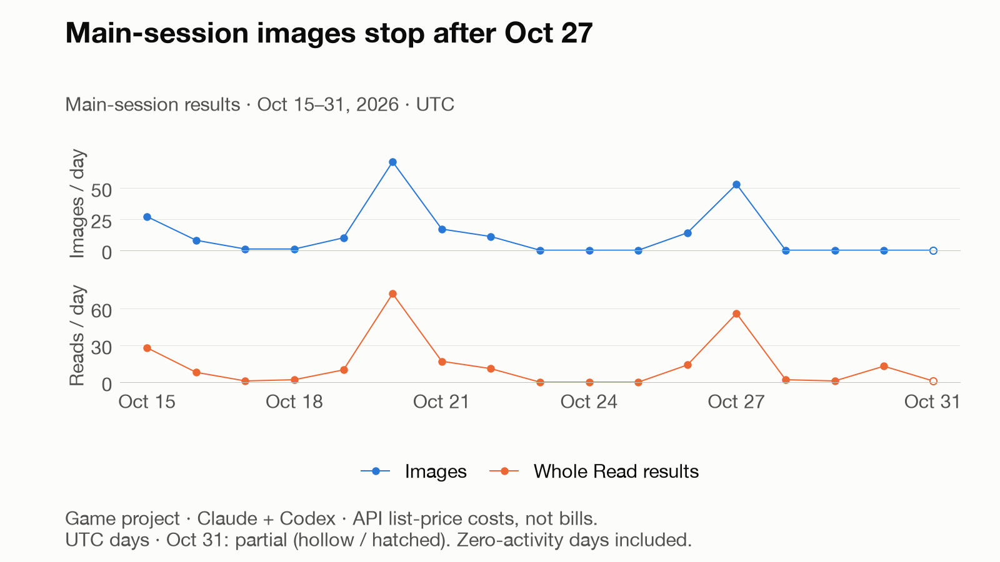

*Figure 6. Main-session images stop after Oct 27. Image results fall to zero; Read results continue at lower counts.*

## 4.6 Batch the wake-ups: swarm leads and merged reviews

**Problem.** Every agent completion wakes the orchestrator at full context. Per-item work (judging 30 review findings, reading 20 slices of a document) meant 30 or 20 wake-ups.

**Change.**

- **Swarm lead.** Per-item judge or scout swarms go through one `haiku-swarm-lead` agent. It spawns the workers (up to 4 items per judge, waves of at most 18), waits for their notifications, and returns one merged table with the full results on disk. The orchestrator acts only on CONFIRMED verdicts; UNCERTAIN goes to a Sonnet verifier.
- **The verifier runs the second review itself.** `sonnet-verifier` starts `codex-review diff` in the background and merges it into its own report, so one wake-up covers both the Claude-side and the Codex-side review.
- **Handle each completion in one response:** integrate, update the plan, launch every next task. Prefer one agent per packet, end to end, over hand-offs through the orchestrator.

This sits alongside an opposite rule: keep the pipeline full. Fewer wake-ups does not mean fewer parallel tasks. Batch completions so each wake-up carries more; keep launching so each wake-up starts more.

**Result.** Wake-ups did not become rarer: about 163 per day before, about 193 after. But the average context per wake-up fell from 521k to 170k (−67%). This is the largest measured win. Direct judge spawns from the orchestrator fell from 23 to 1, replaced by 42 swarm-lead runs, and the median judge run fell from 16 to 9 tool calls.

**Catch.** The swarm lead became a large new cost. See section 8.3.

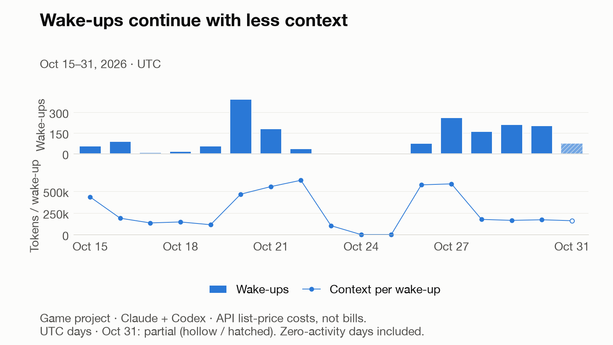

*Figure 7. Wake-ups continue with less context. Wake-up counts vary; context per wake-up falls after Oct 27.*

## 4.7 A code map, and a planner budget

**Problem.** Planning agents made a median of about 190 tool calls per run at about 216k context, mostly grep, read, grep.

**Change.**

- **A code map:** a small local SQLite index of symbols, settings keys and ids over git-tracked files, so an agent finds code in one query instead of a grep-read-grep loop. Commands include `find`, `outline`, `refs`, `setting`, `lang`, `tests` and `brief`. `codemap brief` reads a task brief and prints the code locations it names; the dispatch script inserts that block automatically.
- **An exploration budget** of about 60 tool calls for planners, with "Research needed" instead of open-ended exploring.
- **Right-sized planners:** the top-tier planner only for complex plans; routine plans go to Sonnet or Codex planners.

**What happened first.** After the code map shipped, agents made 5 code-map calls against about 137 greps. The rule to use it was in the main rules file, which lean subagents no longer loaded. It moved into the role context files and the Codex preamble, and the dispatch script started inserting code locations itself.

**Result.**

- Subagent code-map use rose from 4 calls against 5,036 grep/rg calls (0.1%) to 90 against 3,001 (2.9%). Daily shares climbed later (14.9% on Oct 30 in the per-day series, a different cohort), but grep still dominates.
- `opus-planner` runs went from 28 (median 229.5 calls) to 0. Planning moved to cheaper planners.
- Planner exploration did not drop. `sonnet-planner` median calls rose from 93 to 116, against a budget of about 60. The saving came from moving planning off Opus, not from planners exploring less.

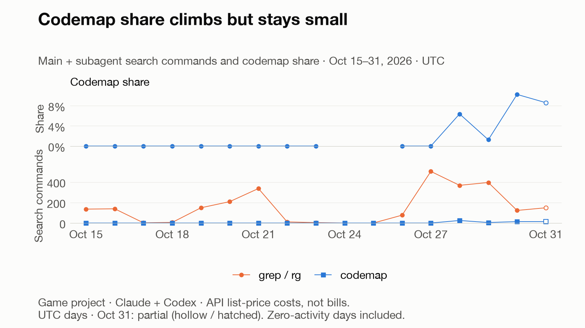

*Figure 8. Codemap share climbs but stays small. Daily shares rise late in the window; the separate clean split reports 2.9% after.*

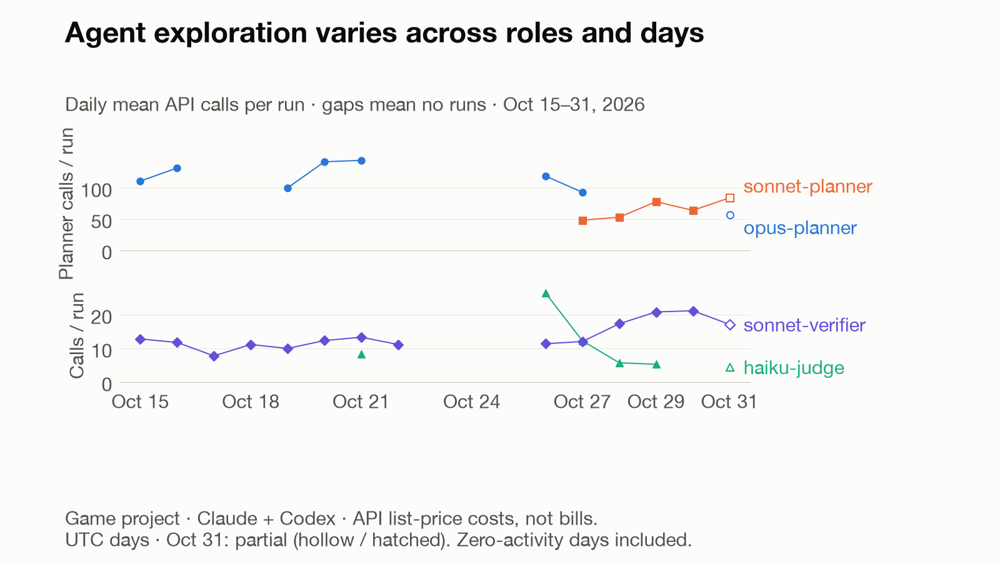

*Figure 9. Agent exploration varies across roles and days. Agent exploration is measured as daily total API calls divided by runs; these are means, not the old tool-call medians.*

## 4.8 A cached fetch

**Problem.** Per-item research judges re-fetched the same history sources again and again: one page 28 times, others 19-25 times, about 20 more 9-16 times.

**Change.** A cached fetch script (`source_fetch`, added 2026-10-28). It stores each page once as plain text in a shared persistent cache, and `--grep REGEX -C N` returns only the matching lines. The swarm lead fetches each URL once, judges do not use raw `curl`, and items are embedded in briefs. Every web call sends a generic browser User-Agent, because several sites refuse default library user agents.

**Result.** Subagents used the cached fetch 1,275 times. Raw `curl`/`wget` fell from about 86 to about 30 per day (−65%). Before the rule reached the agents, the script existed and was ignored.

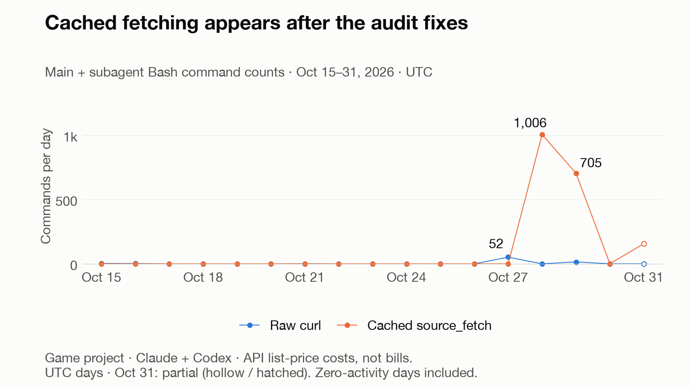

*Figure 10. Cached fetching appears after the audit fixes. Cached fetch sees heavy use on Oct 28–29; counts cover main and subagent commands.*

## 4.9 Trim MCP servers, plugins and descriptions

**Problem.** Tool schemas, connectors, plugins, and the listed descriptions of skills and agents all count as context on every turn.

**Change.**

- Unused claude.ai connectors (calendar, mail, drive, design tools) were denied in the game project's settings with `deniedMcpServers`. A denied server does not load at all, which removes more than a permission deny rule (that only hides the tools).
- Tool search stays on, so MCP tool schemas are deferred until a tool is needed.
- Codex runs that only touch code disable the engine and 3D MCP servers per run with `-c` overrides.
- Skills that only a person triggers set `disable-model-invocation: true`, so their descriptions are not listed each turn. Agent descriptions stay at one or two sentences.

**Result.** No measured saving. The later audit added an "unused tools and MCP servers" section: in 15 sessions and about 2,227 prompts, several built-in tools and three connectors were never used. Deferred tools cost only their name per turn, so the priority is servers loaded in full.

## 4.10 Route by tier and by vendor

**Problem.** Work a cheaper model can do, done by an expensive one, burns the most expensive context in the setup. And a single subscription pool runs out.

**Change.** A standing rule: **delegate down.** For every task, give it to the smallest capable agent: Haiku or Luna first, then Sonnet or Terra, then Sol or Opus, then Fable or Astra last. Before any of that, ask whether a non-AI tool can do it (section 4.12).

| Tier | Claude | Codex | Typical work |
|---|---|---|---|
| 1 | Haiku 5.5 | Luna | Reading, running checks, relaying, swarm work, text transformation |
| 2 | Sonnet 5.5 | Terra | Routine planning, verification, PR review, tests, bounded edits |
| 3 | Opus 5.5 | Sol | Feature work, hard debugging, complex plans |
| 4 | Fable 5.1 | Astra | Escalations, hard decisions; Astra for 3D and visual work |

Vendors are chosen by strength and by pool:

- **Codex** (ChatGPT Pro, weekly cap only, no 5-hour window) gets bulk coding, so Claude's window is kept for orchestration and judgment.
- **Claude** does orchestration, planning, review, anything needing Docker, a browser or MCP, and produced documents.
- **Grok** does web research, tie-break reviews as a third vendor, and bounded overflow coding when the Codex cap is tight. Its claims are leads to verify.
- **Gemini** takes whole-repo and very long document jobs, and visual tie-breaks. Its output is a lead, not a verdict.
- **Reviews cross vendors:** Codex reviews Claude's code and Claude reviews Codex's code. Diffs under about 50 lines the orchestrator reads itself.
- **On a rate-limit or quota error, stop routing to that pool for the session** and use the fallback.

**Result.** At list prices, Codex's share of daily recorded cost rose from 26% on Oct 27 to 63% on Oct 30. Codex spend per active day rose from $113 to $215 (days with Codex logs) while Claude spend per active day fell 42% ($304 → $175). Codex token volume per day rose 3.2 times (217M → 705M). This was intended: bulk coding moved to the pool with no 5-hour window. Cost share is a proxy, not a measure of work moved.

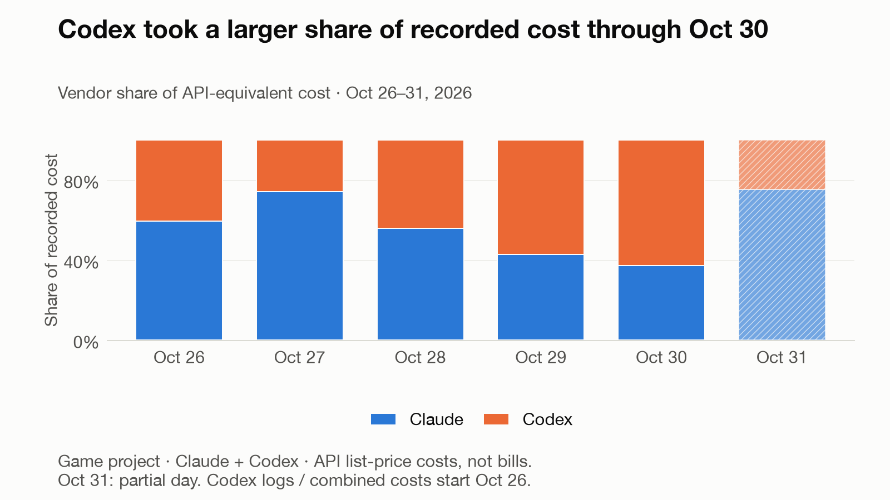

*Figure 11. Codex takes a larger share of recorded cost. Codex takes a larger share of recorded cost after dispatch changes; cost is not a volume measure.*

**This roster is personal.** It reflects one person's subscriptions and one project. Build yours around the tools you pay for.

## 4.11 The Fable cap and the escalation ladder

**Problem.** On 2026-10-19 the orchestrator sent five visual fix rounds straight to `fable-engineer` after two Astra misses. It skipped the higher-effort retry and the Opus engineer. That burned the Fable allowance; Fable hit 95% late that evening and was unavailable until the reset.

**Change.**

- **Retry with more effort before a bigger model.** On a weak result, the first retry is the same agent with a sharper brief that says what was wrong, one effort level higher. Never jump to `max`.
- **Then one rung up.** Implementation ladder: Terra, then Sol (`medium`, then `high`), then `opus-engineer`, then `fable-engineer`. Move up when an agent is blocked or fails verification twice.
- **The Fable cap.** Fable only after every lower rung has failed, and the brief names them. At most one Fable engineer round per packet. More than two Fable spawns in a session needs the owner's OK. At 95% Fable usage, no Fable until reset; Opus at `xhigh` stands in.
- **Escalate on failed acceptance criteria, not nits.** Minor visual residuals go to a polish list.
- **The orchestrator is Opus, not Fable** (section 1.2).

Fable is still used for escalations, audits, security reviews, one design critique per complex plan, and large batch reads over finished work.

**Result.** Fable spend per active day in the Claude-side cost window fell from $26 (10-20..10-27) to $1.21 (10-28..10-30) at list prices.

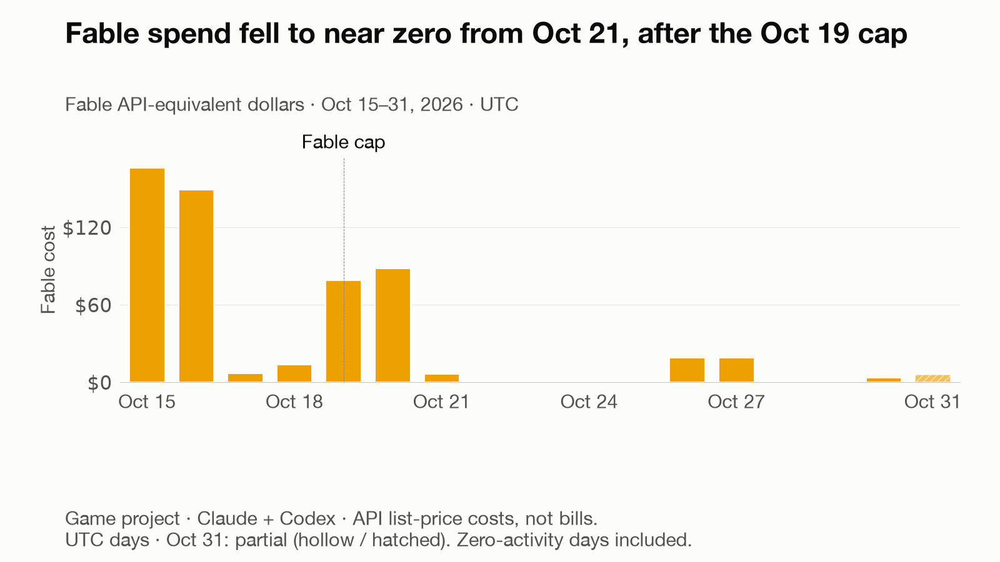

*Figure 12. Fable spend fell to near zero from Oct 21, after the Oct 19 cap. Small Fable costs remain on later days.*

## 4.12 Tools before tokens

**Problem.** Models were reading, counting and transforming things a command does exactly and for free.

**Change.** A rule of about six lines in the rules files for every agent and vendor:

- find code with `rg`, `fd`, `ast-grep` or the code map, then read only the line ranges that matter;
- parse JSON and YAML with `jq` or `yq`; count with `wc`, `sort | uniq -c` or `awk`;
- do bulk edits with `ast-grep`, `sed` or a script, then review the diff;
- send long output to a file and read it with `tail` or `rg`, never whole;
- measure media with tools; models judge only what tools cannot;
- when a manual step recurs, write a script for it.

The audit's list of top shell commands shows which manual steps recur. In the game project, scripts now read test results, summarise batch runs, report test timings and check asset budgets. Briefs name the exact command for every mechanical step and every check.

**Result.** Not measured on its own. The fall in main-session reads (about 30 to about 10 per day) is consistent with it but not attributable to it.

# 5. Results

> **Key takeaway:** The biggest change was not fewer turns but smaller turns. Each orchestrator turn now re-sends about a third of what it did.

## 5.1 The clean split

| Metric | Before | After | Change |
|---|---|---|---|
| Main session: average context per call | 479k | 164k | −66% |
| Main session: peak context | 967k | 367k (217k for sessions started after the 250k cap) | |
| Orchestrator wake-ups | 979 (~163/day) | 540 (~193/day) | about the same per day |
| Average context per wake-up | 521k | 170k | −67% |
| Images in main-session context | 166 | 0 | gone |
| Main-session `Read` results | 180 (~30/day) | 27 (~10/day) | −2/3 per day |
| `codex-engineer` wrapper spawns | 384 (~64/day) | 24 (~9/day) | −86% per day |
| Main session spawning judges directly | 23 | 1 | replaced by 42 swarm-lead runs |
| `haiku-judge` median calls per run | 16 | 9 | |
| Subagent code map vs grep/rg | 4 vs 5,036 | 90 vs 3,001 | 0.1% → 2.9% of searches |
| Subagent raw `curl`/`wget` | 518 (~86/day) | 85 (~30/day) | −65% per day |
| Subagent cached fetch | 0 | 1,275 | adopted |
| `opus-planner` runs (median calls) | 28 (229.5) | 0 | moved to cheaper planners |
| `sonnet-planner` runs (median calls) | 9 (93) | 5 (116) | no drop |
| `sonnet-verifier` median calls | 22 | 28 | no drop |

Before: 6 active days (2026-10-20 to 10-27). After: about 2.8 days from 2026-10-28. Compare rates, not totals.


*Figure 13. The clean split shows lower context and overhead. Frozen clean-split values; corrected combined costs use their own complete-day window.*

## 5.2 Three readings

1. **Per-turn context is the win, not turn count.** The orchestrator wakes about as often per day as before, but each wake-up re-sends about a third as much. Dispatch scripts, image blocking, fewer whole-file reads and the swarm lead all feed this.
2. **Compaction works.** No session started after the 250k change peaked above 217k.
3. **Rules only work once they reach the agents.** The cached fetch and the code map were both ignored until their rules moved into files the agents load.

## 5.3 Over time

The per-day series shows the same story by date. The chart below groups days into four eras: the Fable orchestrator (Oct 15-18), Opus with wrapper agents (Oct 19-26), the lean-agents day (Oct 27), and after the audit fixes (Oct 28-30). The post-audit era has the lowest call-weighted context.

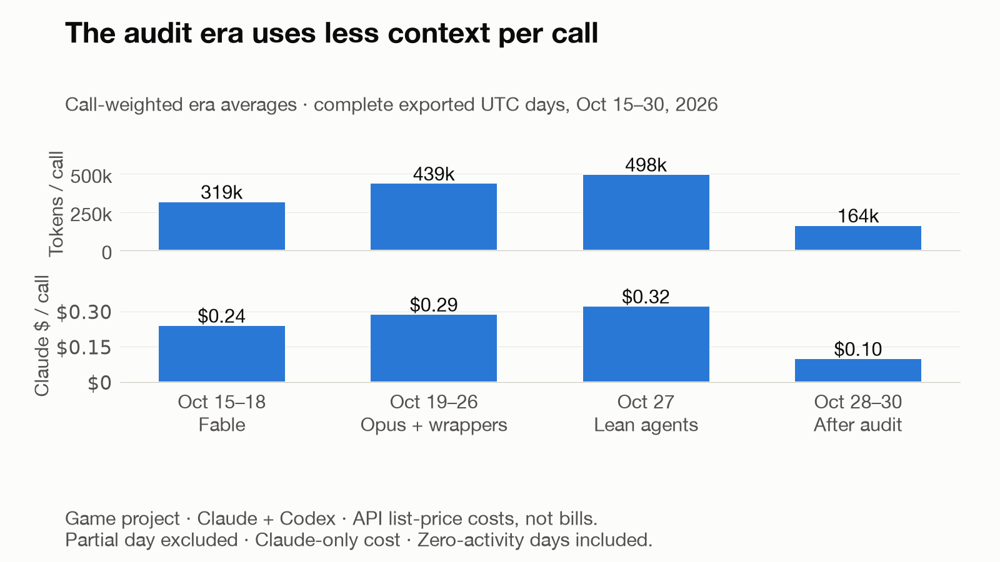

*Figure 14. The audit era uses less context per call. Era context and Claude cost are weighted by main-call counts, not averaged across days.*

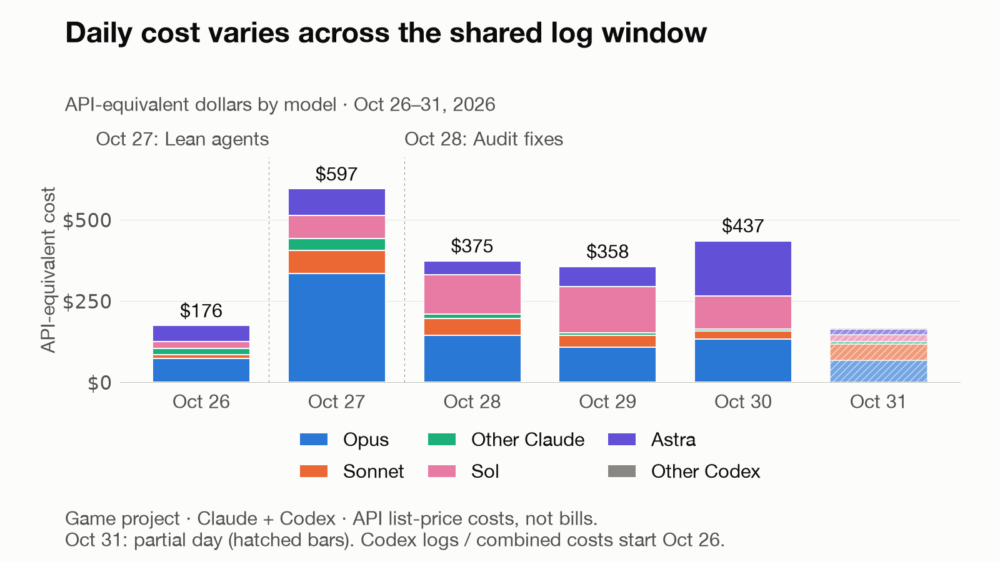

*Figure 15. Daily cost varies across the shared log window. Both vendors have logs from Oct 26; earlier Codex costs are unknown.*

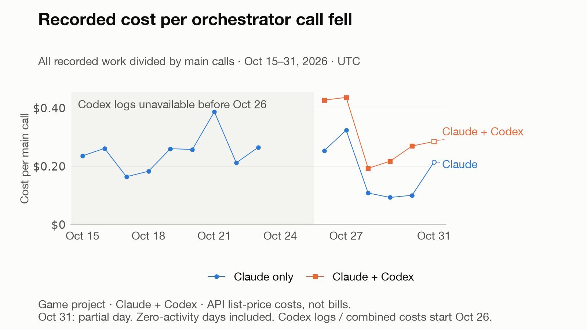

*Figure 16. Recorded cost per orchestrator call fell. A main-call denominator measures orchestration intensity, not cost per shipped feature.*

## 5.4 After the first split

The clean split in 5.1 covers 2026-10-20 to 2026-10-30. Later changes were measured on their own windows; section 7 has the figures and caveats.

| Change (date) | Measure | Before | After |
|---|---|---|---|
| Compaction at 180k (Nov 3) | Average / peak orchestrator context | 161k / 367k | 123k / 217k (weekly review); 109k to 132k average through Nov 17 |
| Risk-tagged batch verification (Nov 3) | Verifier spawns per merge | 1.37 | 0.40 |
| Terra as coding default (Nov 3) | Sol engineer sessions | 144 in four days | 0 in 14 days (confounded) |
| Packet runner and landing (Nov 4) | Tool-result turns per merge | 40 | 24.6 |
| Dotnet-only batch, 20-merge cadence (Nov 4) | Merges since last green | 66 | 38 |
| Packet runner and slot policy (Nov 4) | Slot-wait p90 | 2,903 s | 4,592 s |
| Haiku for exact-change fix items (Nov 10) | First-pass rate | n/a | 21 of 22 items |
| Reading and diff budgets (Nov 4) | `sed -n` calls per planner run; diff characters per verifier spawn | 12.7; 21.6k | 13.8; 29.5k (no effect) |

# 6. Two weeks of usage

> **Key takeaway:** Over the whole window, bulk coding moved to Codex, Claude token volume halved, and tokens per commit fell. Commits are a rough unit, so this is a cross-check on the before/after split, not a proof.

The clean split compares a few days. This section looks at the full window, 2026-10-15 to 2026-10-31, from the per-day series. The last day (10-31) is partial. "Active day" means 50 or more main calls, as before.

## 6.1 Codex volume

Codex session logs only exist from 10-26, so cost cannot be shown earlier. Codex also keeps a state database with a token total for every thread. This paper assigns each thread's lifetime tokens to the day it was created. That gives a volume for the whole window, including cached input. It is not a price, and it is not an exact per-day figure.

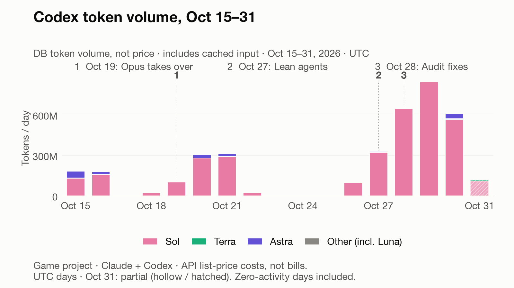

*Figure 17. Codex token volume, Oct 15–31. The state DB covers the full window. Thread lifetime tokens are assigned to creation day; this is volume, not price.*

Codex volume was already about 100M to 340M tokens on a busy day before the changes. It rose to 652M, 854M and 610M on 10-28, 10-29 and 10-30. Per active day it averaged 217M before and 705M after, 3.2 times as much.

## 6.2 Tokens per commit

To get a unit of work, the series counts non-merge git commits per day. Adding Claude context and output tokens to Codex database tokens and dividing by commits gives tokens per commit.

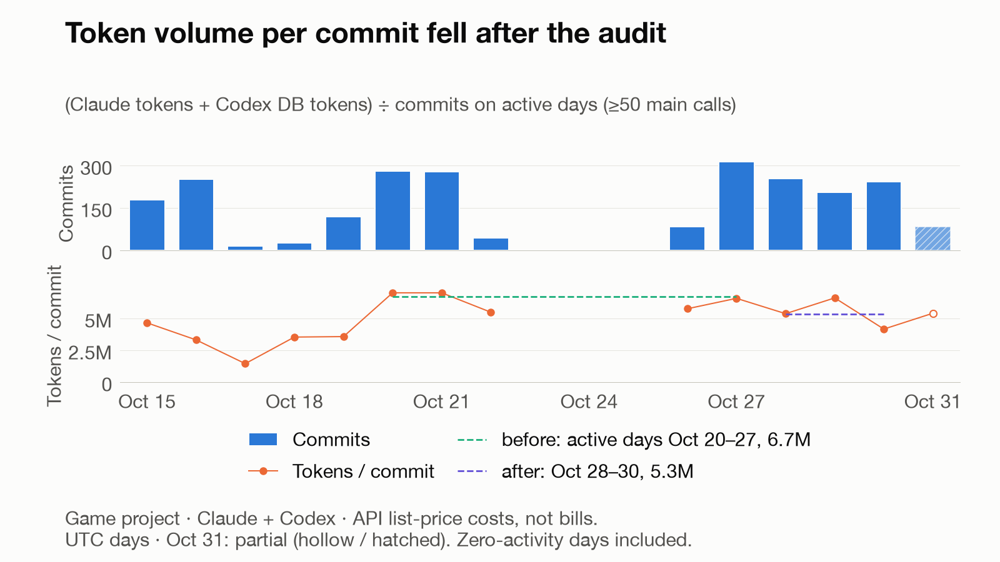

*Figure 18. Token volume per commit fell after the audit. Active-window totals divided by commits: 6.7M → 5.3M tokens per commit. Commit size and workload vary.*

Pooled over the active days, tokens per commit went from 6.7M to 5.3M (−21%). Commits per active day went from 200 to 234. Claude and Codex tokens together went from 1.34B to 1.24B a day (−7%), so the same volume of tokens produced more commits. At API list prices (days with Codex logs), cost per commit went from $1.95 to $1.67 (−14%).

## 6.3 The shift to Codex

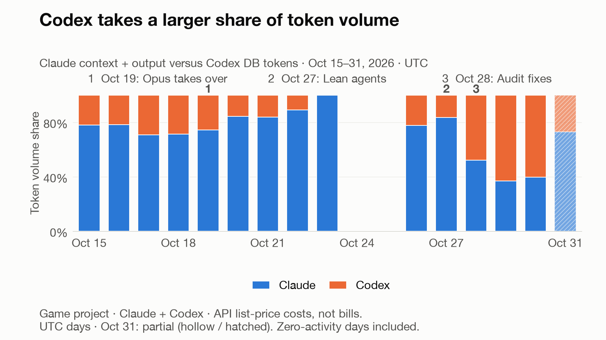

*Figure 19. Codex takes a larger share of token volume. The volume mix shifts toward Codex after dispatch scripts landed Oct 27. DB tokens include cached input and are allocated by thread creation date.*

Codex was 11% to 29% of daily token volume on the days before the changes, and 48%, 63% and 60% on 10-28, 10-29 and 10-30, after the dispatch scripts landed on 10-27. Claude tokens per day fell from 1.12B to 0.54B (−52%) between the two windows. That is the intended outcome: Codex has no 5-hour window, so bulk coding goes there and Claude's window is kept for orchestration. The chart shows volume only. It says nothing about output quality.

## 6.4 Changes against context

Every workflow change is a dated row in a small CSV, with its source, status and whether a number in this paper measures it. The file has 50 rows.

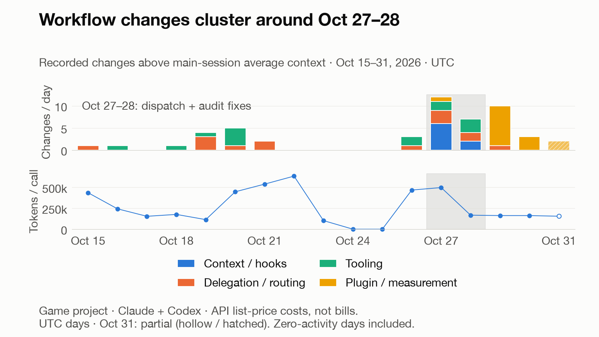

*Figure 20. Workflow changes cluster around Oct 27–28. Each changes.csv row counts once, including superseded changes. The aligned context panel shows timing, not causation.*

The rows cluster: 12 on 10-27, 7 on 10-28 and 10 on 10-29. Main-session mean context was 436k to 635k on the heavy days before (10-15, 10-20 to 10-22, 10-26, 10-27) and 155k to 167k from 10-28 on. The chart shows timing, not cause. Changes landed together, workload varies from day to day, and superseded changes are counted too.

## 6.5 All projects

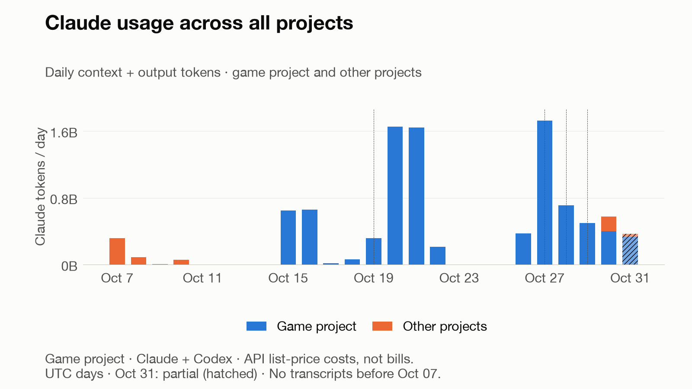

*Figure 21. Claude usage across all projects. All projects from Oct 07: transcripts older than that are not on disk. Other projects equals overall Claude tokens minus the game project.*

The same series can run over every project, not just the game. Transcripts older than 10-07 are no longer on disk, so the chart starts there. The game project accounts for nearly all Claude tokens from 10-15 on. Other projects add to it on a few days: on 10-30, for example, all projects total 575M tokens against 401M for the game. Codex tokens are not included in this chart.

## 6.6 What the per-commit view adds, and what it cannot show

It adds a second denominator. Per main call can fall simply because the orchestrator makes more, cheaper calls. Per commit asks whether more got done for the same tokens. Both point the same way here: tokens per commit −21%, cost per commit −14%.

It cannot show:

- **Commit size.** Commits vary. Some days have large asset or generated-file commits, and a few small commits count the same as one big one.
- **Quality.** A commit is not a working feature. Nothing here measures bugs, rework or review.
- **Cause.** Several changes landed together, and the workload changed. The early days (10-15 to 10-19) had lower tokens per commit, 1.5M to 4.7M, than either window above. This paper does not explain why, so the 6.7M to 5.3M change is a difference between two windows, not a trend from the start.
- **Price for Codex.** Codex volume includes cached input and has no price. Cost per commit needs Codex logs, which exist only from 10-26, so it rests on two before days.

# 7. Weeks three and four (Nov 3 to Nov 17)

> **Key takeaway:** The same loop applied to a second round of problems gave a mixed result. Verification and orchestrator turns got cheaper; routing drifted back toward the expensive engineer, waiting for Unity slots peaked, and the safety nets that depend on a person remembering were late. Everything here is one setup over short, unequal windows.

The first measurement ended on 2026-10-30. Later audits (2026-11-02, 2026-11-04, a weekly review on 2026-11-06 and a project cycle on 2026-11-17) found new problems, mostly in the game project's pipeline rather than in the orchestrator's context. Figures 22 to 30 are drawn from the notes behind this paper and the project's outcome log, not from the clean split. Windows differ between figures and several changes landed together, so none of them shows cause. Costs are API-equivalent list prices.

## 7.1 Context stayed low

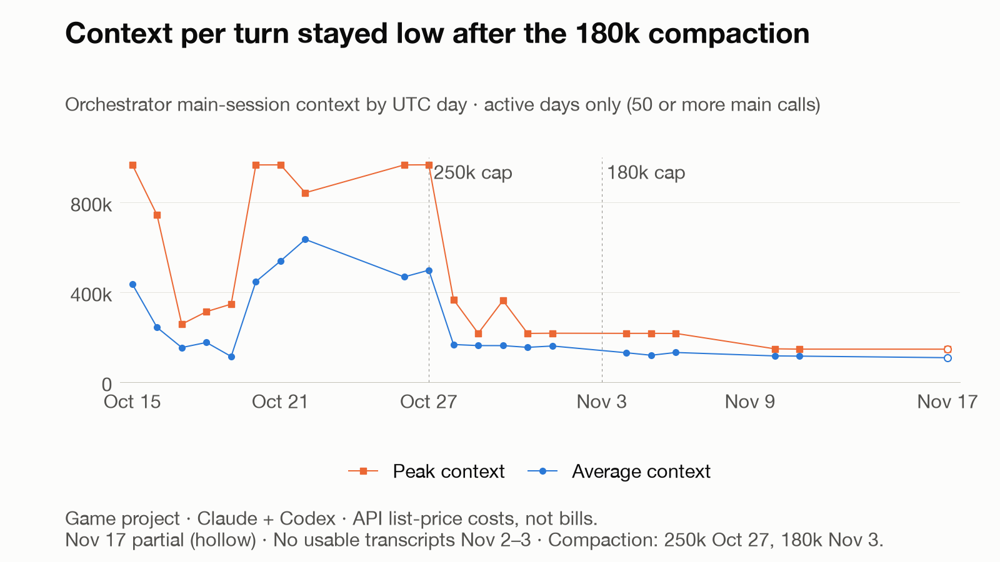

*Figure 22. Context per turn stayed low after the 180k compaction. Average context per call sat near 160k in late October, then 109k–132k from Nov 4 to Nov 17; the peak stayed at or below about 217k, then 147k.*

Compaction moved from 250k to 180k on 2026-11-03. The weekly review compared five active days before with three after: average orchestrator context 161k to 123k (−24%) and peak 367k to 217k. From Nov 4 to Nov 17 the average per active day sat between 109k and 132k and the peak between 147k and 217k. The days Nov 2 to 3 have no usable transcripts, and Nov 17 is partial.

## 7.2 Routing and risk-tagged verification

On 2026-11-02 the audit found Sol, the expensive Codex model, in 257 sessions between Oct 30 and Nov 2: 144 engineer sessions and 104 per-packet diff reviews. The cause was the planners, not the dispatcher. Recent plans named Sol 826 times and Terra 52 times, because the routing text still listed state and data-model work as a Sol reason, and in a simulation game almost every packet touches state. The fix of 2026-11-03 had three parts: a ladder that starts with a Haiku engineer and Terra and uses Sol only with a named reason; a risk tag per packet so that only high-risk packets are reviewed one by one and the rest in batches of three or four; and one final audit per plan.

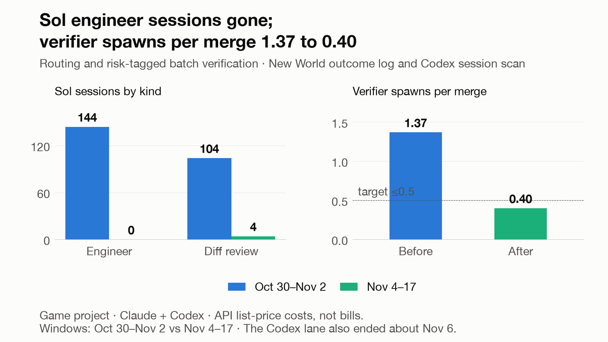

*Figure 23. Sol engineer sessions gone; verifier spawns per merge 1.37 to 0.40. Terra became the coding default and verification became risk-tagged and batched. Catch rate of batch review is not yet verified.*

Verifier spawns per merge fell from 1.37 to 0.40 (68 spawns over 169 merges; the target was 0.5 or less). Sol engineer sessions fell to zero in 14 days, with four Sol diff-review sessions. Terra packets ran about 1.9 times faster than Sol. Two caveats apply. First, the Codex lane itself ended about Nov 6 (the owner ran a Claude-only window on Nov 10 while Codex was unavailable), so the zero is not clean evidence that the rule worked. Second, batch review has not been checked against per-packet review. The shadow review that would do so has not started, 24 batch-review fix packets and 5 final-audit fix packets were needed, and any fix that names a packet counts against it in the calibration report. A later rule made `codex-dispatch` refuse Sol without a `Sol reason:` line, because the weekly review still found 219 Sol engineer sessions after the Terra-default rule.

## 7.3 Pipeline speed: fewer turns, uneven waits

On 2026-11-04 Fable, the most capable model, reviewed the changes and proposed tooling; all of it was built in one plan. The tooling chains a packet from worktree to dispatch to check to landing with one report, tests outside the landing lock, skips the Unity stage for simulation-only changes, runs a .NET-only batch when idle with the full batch every 20 merges, and writes an outcome log per packet. A final audit of that build found 12 more problems (two lock races, a visual-gate bypass, a lost landing output), all fixed in five packets. Two lessons became planner rules: speed packets carry a before/after measurement, and tooling plans end with a real end-to-end run.

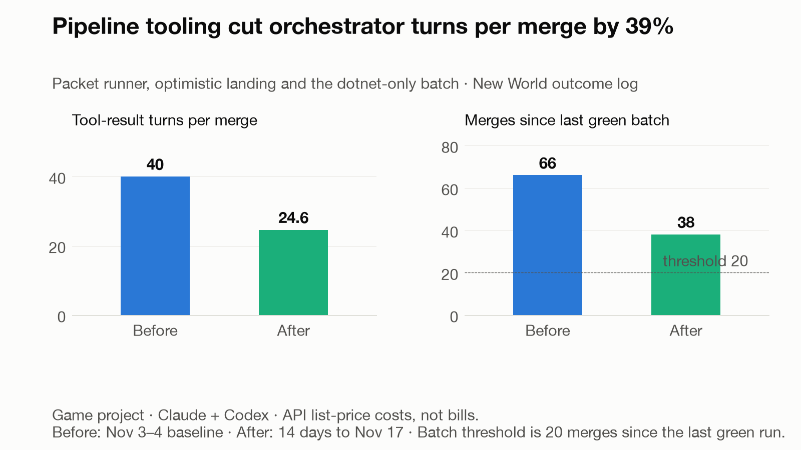

*Figure 24. Pipeline tooling cut orchestrator turns per merge by 39%. Fewer orchestrator turns per merge. The batch is still overdue: 38 merges since the last green run, over the threshold of 20.*

Orchestrator turns triggered by tool results per merge fell from 40 to 24.6 (−39%). In a fixture benchmark, optimistic landing cut the landing lock hold from 5.9 s to 1.3 s (3-run medians); the real-repo effect is not yet measured. Merges since the last green full batch fell from 66 to 38, still above the threshold of 20. The last full batch ran on 2026-11-06, so the trigger that should have prompted the next one did not.

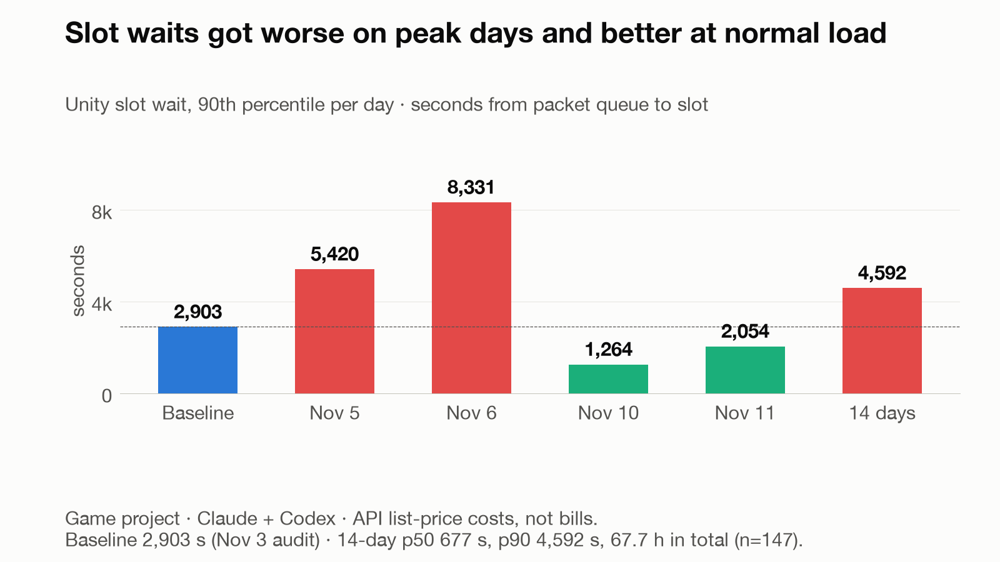

*Figure 25. Slot waits got worse on peak days and better at normal load. 55 of the 67.7 slot-hours fell on Nov 5–6. Nov 10–11 were better than baseline. The Unity slot cap is the constraint.*

Waiting for a Unity slot got worse on peak days and better at normal load. Over 14 days the slot wait had p50 677 s and p90 4,592 s, with 67.7 hours in total across 147 checks, against a 2,903 s p90 baseline. Of those hours, 55 fell on Nov 5 and 6. Slot wait is still a lottery: the slot lock is a polling loop with no queue order. Fable's ideation pass added an observation with a caveat: 135 packets summed to about 740 hours of wall time, of which 67.7 hours was slot wait, about 21 hours PlayMode and about 3 hours .NET. That points at waiting between steps (for a review, a brief or a landing) as the likely largest share. Per-state times are not logged, so that share is an estimate, and the first proposal is to log them.

## 7.4 The weekly review: where the cost went

The review of Oct 30 to Nov 6 found about $1,670 of list-price cost across 20,316 Claude calls and 1,191 Codex sessions. Cost per day rose from $273 to $362 (+33%) after the Nov 4 changes, nearly all of it Codex (2.36 times the daily Codex cost), while commits per day went from 125 to 155 and crude cost per commit from about $1.86 to about $1.44. The after period also landed 255 commits in a second project, so cost per commit fell by more than the game's own figure shows.

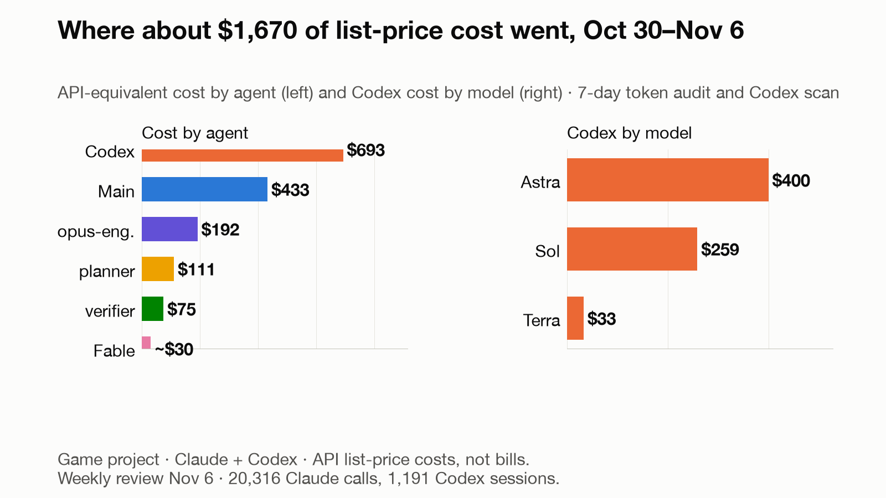

*Figure 26. Where about $1,670 of list-price cost went, Oct 30–Nov 6. Codex was 41.5% of the week, the orchestrator 25.9%. Within Codex, Astra on visual Unity packets was the largest single item.*

Astra, the most expensive Codex model per token, was the largest single cost item: $400 of $692 Codex cost, with Astra costing about ten times Sol per token and $185 on Nov 5 alone. It was used for visual Unity packets.

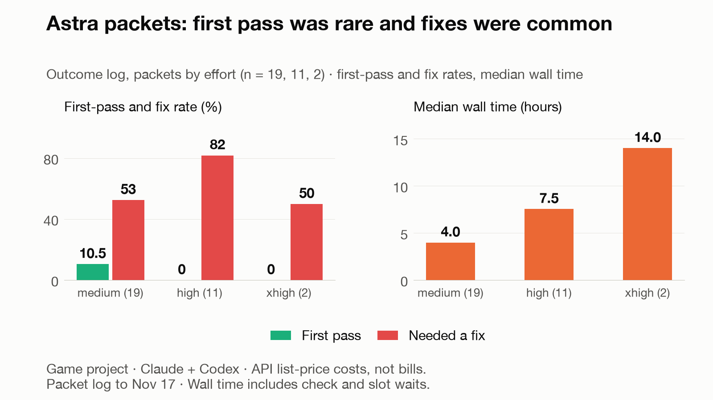

*Figure 27. Astra packets: first pass was rare and fixes were common. Astra packets rarely passed first time and took hours. The visual-fix cap and scripted checks were added on Nov 6 and have not been re-measured.*

In the outcome log Astra packets rarely passed first time: first-pass 10.5% at medium effort (19 packets), 0% at high (11) and xhigh (2), with fix rates of 50% to 82% and median wall times of 4.0 to 14.0 hours. One packet reached round 4. On Nov 6 the rules changed to at most two visual fix rounds per packet, then a debugger or the polish list, with each Astra Unity brief carrying a scripted measurable check. That change has not been re-measured, because Astra use also stopped with the Codex lane. The review also found waste in orchestrator Bash output (5,780 calls returning 6.9M characters), an Edit error repeated 7 times, and unused connectors loading their instructions each turn. In the next audit window (Nov 7 to 10, one active day) the orchestrator made 452 Bash calls returning 556k characters, which is lower but too short a window to credit the burst-warning hook.

## 7.5 Handing exact-change fixes to the cheapest model

On Nov 10 a review of the plugin produced a batch of fix items. All eight fix packets first went to a Sonnet engineer because findings were bundled by file and one hard item promoted each bundle, though roughly a quarter of the items had the exact change stated. The rule became: split a mixed batch by tier before by file, so exact-change items go to the Haiku engineer.

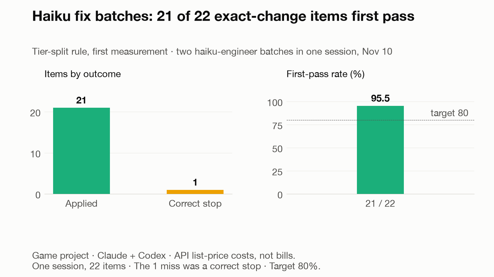

*Figure 28. Haiku fix batches: 21 of 22 exact-change items first pass. The rule was then refined: fewer than about four exact items in files the higher tier must open stay with that tier. One session is a first data point only.*

In the first measurement, two Haiku batches handled 22 exact-change items: 21 applied at the first pass and 1 stopped correctly on an ambiguous instruction. The rule was then refined, because two later batches showed a separate Haiku spawn costs more than two or three one-line items; fewer than about four exact items in files the higher tier must open stay with that tier. This is one session and a first data point only.

## 7.6 The 2026-11-17 cycle: what got worse

A propose-only cycle on the game project over 14 days found $836 of list-price cost: orchestrator $298 (36%), opus-engineer $220 (26%), fable-architect $89 (11%) and sonnet-planner $58, with Codex almost gone ($1.70).

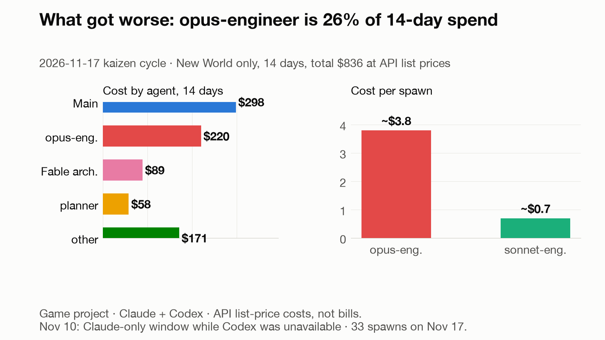

*Figure 29. What got worse: opus-engineer is 26% of 14-day spend. Engineering moved from Codex to Claude after Nov 6 and opus-engineer took a quarter of spend. Whether the routing rule was ignored or Codex was unavailable is still open.*

Opus-engineer drift is the clearest regression. The Nov 6 rule asked for briefs naming the lower rungs that had missed, yet opus-engineer runs rose: 58 spawns since Nov 10, 33 of them on Nov 17, at a median of 61 minutes with 16 over two hours, and about $3.8 per spawn against about $0.7 for a Sonnet engineer. Part of the cause is the Claude-only window on Nov 10. Fourteen parallel Fable critics on Nov 17 (about $75) were apparently requested by the owner. Whether the routing rule is simply being skipped is open; the first proposal is to restore the ladder and then check that opus-engineer stays below ten spawns a week.

The cycle also measured the reading and diff budgets from the Nov 4 audit and found no effect: `sed -n` calls per planner run were 12.7 before and 13.8 after, and `git diff` characters per verifier spawn rose from 21.6k to 29.5k, although planner tokens per run fell from 17.5M to 13.2M on four runs. Other findings, each recorded as a proposal and not yet applied:

- The outcome log has gaps: Opus and Sonnet packets log zero input tokens, model labels are split, 7 landed packets show checks failing, and per-stage timestamps are missing.
- The overdue batch (38 merges since green) and the unstarted shadow review.
- Slot-wait peaks, to be capped by limiting concurrent Unity dispatches to the slot count and replacing polling loops.
- Fable's ideation pass produced 46 ideas, none applied. Its top ten: a packet timeline and then a conveyor that advances packets without waking the orchestrator; a visual gate in the dispatch loop; a look-sweep rig; a Unity slot priority queue; a severity gate with honest calibration; a nightly batch; check-failure triage; a balance lab and bot zoo; cache-aware wake-ups; selecting journeys per packet. Several conflict with owner rules and need a decision.

## 7.7 The plugin, 0.6.0 to 0.9.1

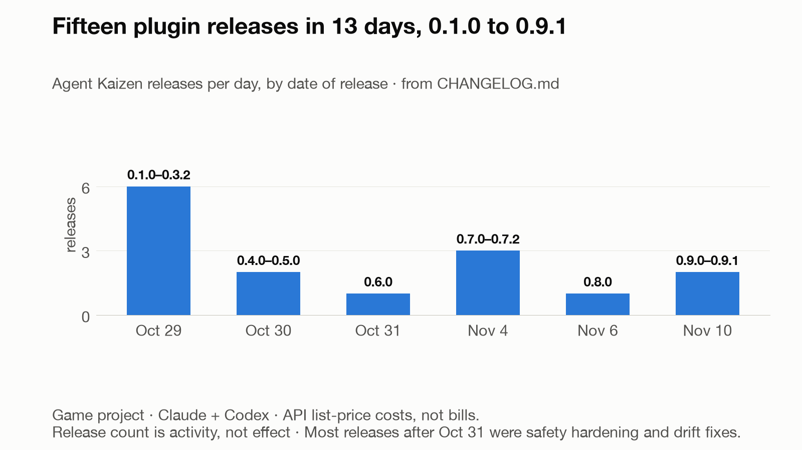

*Figure 30. Fifteen plugin releases in 13 days, 0.1.0 to 0.9.1. Releases track what the audits and reviews found: usage-series (0.6.0), the port and scheduled-run hardening (0.7.x), the 2026-11-06 review fixes (0.8.0), a full review and usage database (0.9.x).*

Agent Kaizen went from 0.1.0 to 0.9.1 in 13 days, 15 releases. Releases after the first week were mostly hardening: usage-series and usage-compare (0.6.0); the port of the owner's private scripts, the packet outcome report with calibration proposals, a ledger tool and rules-lint (0.7.0); planner and verifier budgets (0.7.2); the require-change and Sol-reason guards and the bash-burst hook from the weekly review (0.8.0); a full review, a usage database that keeps per-call history after Claude Code deletes old transcripts, and auto mode only for listed projects (0.9.0); and recovery after a hard kill, plus backup pruning (0.9.1). After the port, the drift check reported 0 drifted and 0 broken scripts (10 intended local differences) and 0 stale-rule hits on 2026-11-16. In progress, not released: version 0.10.0 (a flow report, an experiments register, honesty fixes to the packet report, a brief lint and a due-check reminder), and continuous integration moving to tag-only runs.

## 7.8 Data caveats for this period

Claude Code and Codex delete old session logs. The early rows of the daily series were kept as exported; later rows hold what the transcripts still show, with Nov 2 to 3 and Nov 12 to 15 empty, and the usage database supplies calls, tokens and cost where logs are gone. Codex costs before Nov 4 come from the earlier exports only. Several figures above come from audits with different windows, a different project mix (the all-project audits include other repositories) and small samples.

# 8. What didn't work, or made things worse

> **Key takeaway:** The ledger did its job. Some changes we expected to help did not, and one fix created a large new cost of its own.

## 8.1 Changes that did not move the numbers

- **The planner exploration budget.** A budget of about 60 tool calls for planners did not reduce exploration. The `sonnet-planner` median went from 93 to 116 calls. Planning cost fell only because work moved off Opus planners.
- **The code map, so far.** It reached 2.9% of code searches in the clean split. Daily shares are climbing, but grep still wins. The tool works; the habit has not changed.
- **Verifier effort.** `sonnet-verifier` median calls went from 22 to 28.
- **Wake-up count.** Batching did not reduce the number of wake-ups per day (about 163 to about 193). Each became smaller instead.
- **Trimming connectors.** Done, but no saving was measured.
- **Reading and diff budgets (2026-11-17).** Planner `sed -n` calls per run were 12.7 before and 13.8 after; verifier diff characters per spawn rose from 21.6k to 29.5k. The templates were changed; agent behaviour was not.

## 8.2 Rules that never reached the agents

The clearest lesson in this work. After the code map shipped, agents made 5 code-map calls against about 137 greps. The cached fetch script existed and was ignored. In both cases the rule lived in the main rules file, which the lean subagents had stopped loading. Once the rules moved into the role context files and the Codex preamble, the cached fetch was used 1,275 times and code-map use rose.

Lean context and rule reach pull against each other. Every rule you remove from an agent's context is a rule it no longer follows. Check, in the transcripts, that the rules you care about are followed.

## 8.3 Fixes that created a new cost

- **The swarm lead.** It was added to cut wake-ups and it did merge results. But within two days the swarm leads accounted for about half of all Claude output that week: 34.2M output tokens across 41 spawns. They polled with `sleep 200-300` loops (130+ sleep calls), spawned workers in waves (123-199 Agent calls per lead) at `high` effort, and hit the concurrent subagent limit, retrying up to 95 times in one turn. Across sessions the "concurrent subagent limit reached" error appeared 387 times. The proposed fix (spawn all workers in one message, no sleep loops, `low` effort for the lead) has not been applied yet.
- **Cheap models in bulk.** Haiku produced 57.0M output tokens in 7 days, against 9.5M for Opus. Cheap models are cheap per token, not in volume. In the Claude-side cost window, Haiku spend per active day rose from $6.78 to $7.87.
- **Wrapper agents "to save effort".** The wrappers were a cheap model relaying a script's output, and still cost about 535M context over 171 spawns. A cheap model with a full agent context is still a cost per spawn.

## 8.4 Stuck turns

In the later audit, 29 of 2,254 turns (1.3%) were stuck: the same failure three or more times in a turn. They used 2,147 tool calls and $33.62 at list prices, 2.2% of the window's cost. Almost all were the concurrent-subagent-limit retries above. Real, but small next to the orchestrator's own context.

## 8.5 Things that needed a second try

- **A guard with no way out.** The first big-read guard denied whole-file reads outright. Agents that needed the whole file got stuck. The deny message now spells out the override.
- **Fable fix rounds that skipped the ladder** (section 4.11).
- **Engine "run only affected tests".** The engine's own option selected nothing in two spikes, so tiered test runs stayed.
- **Verification without a control.** Unrelated to cost, but worth knowing: a zero-allocation test helper returned 0 in the engine's batch runtime, so every "allocates nothing" test (46 call sites in 19 files) passed vacuously. It was replaced by a helper with a positive control. A filtered test run on one packet missed 15 failures, so the full suite now runs on any packet that touches engine or UI-model code. "Verified" needs a control.

## 8.6 What got worse in weeks three and four

- **Opus-engineer drift.** After a rule to make it rare, it took 26% of 14-day spend (section 7.6).
- **Slot-wait peaks.** The 90th percentile of Unity slot wait was 4,592 s over 14 days against 2,903 s; 55 of 67.7 hours fell on two days.
- **Safety nets that depend on memory.** The full batch was 38 merges overdue against a threshold of 20, and a three-week shadow review had no rows two weeks in. A tool that merely exists does not close the loop; the trigger needs wiring.
- **An unproven saving.** Fewer verifier spawns per merge is measured; that batch review catches what per-packet review did is not.
- **An outcome log that misleads.** The calibration report proposes moving every Terra row up a rung because any fix naming a packet counts against it, and Opus and Sonnet packets log no tokens.
- **A measurement trap.** A plain refresh of the daily series dropped early days and the Codex costs, because Claude Code and Codex had deleted the logs. The refreshed numbers were lower for reasons unrelated to the setup.

# 9. What it saved, honestly

> **Key takeaway:** On flat subscriptions the bill did not change. What changed is headroom. At API list prices, cost per main call roughly halved while the orchestrator made about 1.7 times as many calls, and total spend per day stayed flat.

## 9.1 Money actually paid: unchanged

The setup runs on Claude Max and ChatGPT Pro, which are flat subscriptions. No bill went down. The gain is headroom under the 5-hour and weekly limits. David's experience matches that: sessions rarely reach compaction or the limits now. Anthropic does not publish how tokens count against subscription limits, so headroom cannot be turned into a number.

## 9.2 API-equivalent cost

To compare before and after, tokens are priced at published API list prices. This is a weighting, not a bill.

**Claude side** (10-20..10-27, 5 active days, against 10-28..10-30, 3 days):

| Metric | Before | After | Change |
|---|---|---|---|
| Main calls per active day | 1,009 | 1,741 | about 1.7× |
| Main context per call (all calls) | 492k | 164k | −67% |
| Claude tokens per day (context plus output) | 1.12B | 0.54B | −52% |
| Claude spend per active day | $304 | $175 | −42% |
| Claude cost per main call | $0.30 | $0.10 | −67% |

Claude spend per active day, by model family (the windows differ in length, so these are per day):

| Model family | Before | After |
|---|---|---|
| Opus 5.5 (orchestrator plus Opus agents) | $236 | $129 |
| Sonnet 5.5 | $35 | $37 |
| Fable 5.1 | $26 | $1.21 |
| Haiku 5.5 | $6.78 | $7.87 |

The context figure here (492k) covers all main calls. The 479k in section 5 covers calls the audit could classify by trigger. Both fall to 164k.

**Claude plus Codex** (10-26..10-27 against 10-28..10-30, the days where both have logs):

| Metric | Before (2 days) | After (3 days) | Change |
|---|---|---|---|
| Codex spend per active day | $113 | $215 | about 1.9× |
| Total spend per active day | $386 | $390 | flat |
| Total cost per main call | $0.43 | $0.22 | −48% |
| Cost per commit | $1.95 | $1.67 | −14% |

Total spend per day was flat while the orchestrator made about 1.7 times as many calls. The Claude side fell 42% a day; the work that left it went to Codex, as intended.

## 9.3 A counterfactual for the orchestrator alone

If the 5,224 main calls of 10-28..10-30 had carried the before average context (491,892 tokens instead of 164,436), each would have re-sent 327,456 more tokens. That is about 1.71 billion tokens in all. Opus 5.5's cached-input price in the plugin's `pricing.json` is $0.20 per million tokens, so the extra cost is about $342 over 3 days, about $114 a day.

This is a lower bound, because it prices cached input only and treats every main call as Opus. It is also partly hypothetical: at the old context size the usage limits would have stopped the session long before it made that many calls.

## 9.4 Why there is no single "we saved $X"

- **Commits are a rough unit of work.** The after window had a different workload and about 1.7 times the main calls per day.
- **Changes landed together.** The numbers show the combined effect.
- **Short windows.** Two to five days before (two with Codex logs), three days after.
- **Approximate pricing** that slightly understates cost.
- **The analysis itself** cost sessions that were not separated out.

So the honest summary is: "On a flat subscription the bill didn't change. What changed is headroom. Main-session context per turn fell about two thirds. At API list prices, cost per main call roughly halved ($0.43 → $0.22) and total spend per day stayed flat, while commits per day went from 200 to 234."

# 10. Playbook for individuals

> **Key takeaway:** Measure first, fix the orchestrator's context first, and change one thing at a time.

Your setup is not this one. The order below is the order of payoff we saw; your audit may rank things differently. Follow your numbers.

## 10.1 What to measure first

Run a zero-token audit over your own transcripts (section 12 shows how) and look at five numbers:

1. **Average and peak context of your main sessions.** Anything in the hundreds of thousands is the first target.
2. **Turns per session, and how many are agent-completion wake-ups.** Multiply by the context to see what each wake-up costs.
3. **Spawns per agent type, with median context and tool calls.** Look for agents that only relay, and for agents with very high tool-call counts.
4. **Images and whole-file reads in the main session.**
5. **Repeated commands and URLs.** Anything fetched or run by hand many times is a script waiting to be written.

Write these down as a baseline before you change anything.

## 10.2 The fixes, in order of payoff

1. **Compact earlier, and keep state in files.** Set an auto-compact threshold well below your peak. Add a post-compaction hook that points the session back at its plan files. One setting and one short hook.
2. **Keep images and big files out of the orchestrator.** Two `PreToolUse` hooks with clear overrides. Send image questions to an image agent or a script.
3. **Replace relay agents with scripts.** If an agent only runs another CLI and passes the answer back, write a script that runs it in the background, runs your checks, and prints a capped report. Have the orchestrator read only the report.
4. **Batch completions.** One lead agent for per-item work, returning one merged table. Have the verifier run the second review itself. But tell the lead your concurrency limit, and forbid sleep loops. Measure it after.
5. **Give subagents lean context.** Skip the big rules file for custom agents; inject a few lines of shared rules and one role file. Then check that the rules you care about still reach them.
6. **Delegate down and cap the top tier.** Cheapest capable model first. Retry with a sharper brief and more effort before moving up. Cap the most expensive model per session. Do not let ad-hoc spawns inherit the orchestrator's model.
7. **Tools before tokens.** Install `rg`, `fd`, `ast-grep`, `jq`. Put a six-line rule in your rules files. Script the steps your audit shows agents doing by hand.
8. **Cache what agents fetch.** If the audit shows repeated URLs, add a cached fetch with grep.
9. **Trim what loads every turn.** Deny unused connectors per project, keep tool search on, make user-only skills non-model-invocable, keep agent descriptions short.
10. **Give exploring agents a better map, and check it is used.** A code map helps only if agents use it; in our case it took a rule move and automatic insertion to get any use at all.

## 10.3 The loop: measure, change one thing, re-measure, keep or revert

1. **Measure.** Run the audit. Keep the report private; it holds paths and prompt fragments.
2. **Pick one change** (at most a few), ranked by expected saving per unit of effort.
3. **Log it.** One ledger row per change: date, change, why (which finding), expected effect, measured effect, keep or revert. Leave "measured effect" empty.
4. **Back it up and make it.** Keep a way to undo it.
5. **Re-measure** at the next audit. Fill in the measured effect from numbers, not impressions.
6. **Keep, tune or revert.** If it did not move the numbers, revert it.

| date | change | why | expected | measured | verdict |
|---|---|---|---|---|---|
| 2026-10-28 | Cached fetch script for research judges | Same pages fetched up to 28 times | Fewer raw fetches | Raw curl −65% per day; 1,275 cached fetches | KEEP |
| 2026-10-28 | Planner exploration budget (~60 calls) | Planners at ~190 calls per run | Fewer calls per planner | Sonnet median 93 → 116 | no effect |

*Example rows built from this paper's measurements, in the ledger format.*

Why one change at a time: if many things change at once, the next audit cannot say which change did what. Our own clean split shows the cost of breaking this rule. Several changes landed together, and we cannot attribute the result to any one of them.

## 10.4 Habits for the orchestrator

- Write a standalone brief to a file; hand over the path, not a re-authored copy.
- Launch background work and wait for the notification. Never poll.
- Read reports, not logs. Open logs only when the status is bad.
- Handle each completion in one response: integrate, update the plan, launch every next task.
- Read small diffs yourself; send larger ones to a verifier from a different vendor.

# 11. Playbook for teams and companies

> **Key takeaway:** The same loop works for a team, but it needs shared rules files, a shared ledger, budgets per agent type and clear limits on what automation may change.

This section turns the individual practice into team practice. It is a recommendation based on this setup, not a measured result from a team.

## 11.1 Shared rules files, split by audience

- Keep a short core rules file that every agent needs. Move topic rules into docs that agents read when the task matches. Keep orchestrator-only rules in a file that subagents never load.
- Keep role context files (coding, planning, review, research) in the repository, next to the code, and review changes to them like code.
- Put each rule where the agents that need it will load it. Then verify, from transcripts, that it is followed. "A rule an agent never sees does not help" applies to a team's rules as much as to one person's.
- When slimming a rules file, list every dropped or merged rule and why. Silent loss is the risk.

## 11.2 Budgets per agent type

- Report cost per agent type, not just per person or per project. The plugin's audit does this (since 0.5.0), with a hint when an agent type could run on a cheaper model.
- Set expected ranges per agent type: median context, median tool calls, spawns per day. Review outliers, not averages.
- Cap the top-tier model per session, and require a named reason (the lower rungs that failed) to escalate.
- Treat the orchestrator as the main budget line. In our audit the main session alone was about a third of API-equivalent cost.

## 11.3 A measured change ledger

- One ledger per project, in the repository. Every change to agent configuration, rules, hooks or routing gets a row.
- The "measured effect" column is filled from the next audit, by whoever reviews it, not by the person who made the change.
- Limit changes per review cycle so effects can be attributed. The plugin defaults to at most 3 changes per run.
- Do not run two optimisation tools in the same project at once. The ledger cannot tell which change did what.

## 11.4 A review cadence

- Run the zero-token audit on a schedule. We use every 3 days.
- Review the audit weekly against the ledger: fill in measured effects, keep or revert, choose the next changes.
- Monthly: check for new models and new tool releases. A new feature can make a workaround pointless, and a cheaper model can take over a whole routing row. Trial one row at a time.
- Re-check the roster when you add or drop a subscription.

## 11.5 Spread load across vendors and pools

- Know each pool's limits: rolling windows, weekly caps, separate allowances for top models.
- Route bulk work to the pool with the most headroom, and keep the most constrained pool for the work only it can do.
- Give every routing row a fallback on another vendor at the same tier, and stop routing to a pool for the session on its first quota error.
- Use a different vendor to review than the one that wrote the code.
- Remember the privacy side: sending repository code to a vendor that has not seen it before is a decision, not a routing detail.

## 11.6 Governance of auto mode

Automation that changes agent configuration needs limits that do not depend on the model's judgment.

- **Default to propose.** Every change is shown as a diff and waits for approval. Move to a "safe" mode (low-risk, reversible changes only) and then to auto only when the loop has earned trust.
- **Hard stops in every mode:** secrets, spending money or using a new vendor, loosening permissions, deleting anything, outward-facing actions (commits, pushes, PRs, messages), installing packages, changing scheduled jobs, and changing the autonomy setting itself.
- **Every applied change** is backed up, verified right away, rolled back on failure, logged with its backup location, and undoable.
- **Unattended runs get less, not more.** In the plugin, scheduled auto runs use a restricted tool list and deny rules, never bypass permissions, and may edit instruction Markdown only, never settings, hooks, scripts or credentials.
- **Keep audit reports private.** They contain file paths and prompt fragments.

# 12. Agent Kaizen: automating the loop

> **Key takeaway:** Agent Kaizen packages the audit, the ledger and the one-change-at-a-time loop as a Claude Code plugin. It only sets up the tools you have.

Agent Kaizen is an open-source Claude Code plugin (github.com/HighwayofLife/agent-kaizen, MIT licence). It grew out of this work on 2026-10-29. In the launch post's words: "this stuff drifts. New habits creep back in, Claude Code ships a feature that makes one of my workarounds pointless, a cheaper model comes out. A one-time cleanup doesn't stick."

## 12.1 The loop

1. **Measure.** `token-audit` runs every 3 days from the operating system scheduler (launchd on macOS; cron, or a systemd user timer when cron is not available, on Linux). It is a script and spends no tokens. A session-start hook tells you when an audit has not been reviewed.
2. **Review.** `/agent-kaizen:review` or `/agent-kaizen:cycle` compares the newest audit with the ledger, fills in measured effects, and proposes the next changes.
3. **Change one thing** and log it in `docs/kaizen/LEDGER.md`.
4. **Re-measure.** The next audit shows whether it paid off: keep, tune or revert (`/agent-kaizen:undo`).

David on the ledger: "That ledger has been the most useful part. A few things I was sure would help barely did anything."

## 12.2 What it includes

- **Loop skills:** `start` (ledger, loop README, baseline of what loads every turn), `audit`, `cycle`, `review`.
- **Change skills:** `roster`, `slim-instructions`, `trim-context`, `lean-agents`, `codex-dispatch`, `tools-before-tokens`, `code-map`, `guardrails` (big-read guard, image guard, compaction hook, each with an override), `batch-wakeups`, `planning`, `test-loop`.
- **Checking skills:** `models` and `whats-new`, monthly.
- **Control skills:** `autonomy` (propose, safe, auto), `undo`, `schedule`.
- **Scripts:** `token-audit`, `usage-series`, `usage-compare`, `codex-dispatch`, `codex-review`, `dispatch-status`, a backup and undo script. Python 3.9+ standard library and shell only.

All skills are user-triggered, so their descriptions add no per-turn context. Installing the plugin enables only the audit-notice hook; the guardrail hooks are opt-in.

## 12.3 The roster step

`/agent-kaizen:roster` works out which AI tools you have and pay for (agent CLIs on PATH, sign-in status, API-key variable names but never values, local models, MCP servers, existing agents). It asks you to confirm each plan's limits and which pool to protect. It researches what each model is good at today from primary sources with dates, optionally runs a small bake-off on your own repository (after asking, because it sends code to each vendor), and builds a routing table with a fallback and an escalation for every row. It prefers dispatch scripts over relay agents, and creates thin agents only where an isolated context helps.

Our roster (Claude for orchestration and planning, Codex for most coding, Grok for research, Gemini for giant documents) is one example. Yours will be different, and the roster step only sets up what you have.

## 12.4 Safety

The default mode is propose. Auto mode applies changes but backs each one up, verifies it, rolls back on failure, logs it, and keeps an undo. It always stops before keys, spending, loosening permissions, deleting anything or pushing code. No script commits or pushes.

## 12.5 Releases since the launch

From 0.6.0 to 0.9.1 (2026-10-31 to 2026-11-10) the plugin added a published usage series and comparison (0.6.0), a private-script linker with drift check, a packet outcome report with calibration proposals, a project report, a ledger tool and rules-lint (0.7.0), reading budgets (0.7.2), guards against empty and expensive dispatches and a bash-burst warning (0.8.0), a usage database, scheduled-run hardening and backup pruning (0.9.x). See section 7.7 and the plugin's CHANGELOG.md. Version 0.10.0 is being planned and has not been released.

## 12.6 Install

Inside Claude Code:

```
/plugin marketplace add HighwayofLife/agent-kaizen
/plugin install agent-kaizen@agent-kaizen-tools
/agent-kaizen:start
```

Then `/agent-kaizen:audit` and `/agent-kaizen:roster`. It needs `jq` and Python 3.9+. It works with or without Codex. Every skill is a plain Markdown file, so you can also point Claude Code at a clone and ask it to follow a skill without installing the plugin.

# 13. Limits of these findings and next steps

> **Key takeaway:** These are early findings from one person, one project and a few days of data. Treat them as a method and a set of leads, not a benchmark.

## 13.1 Limits

- **One setup.** One developer, one game project, one large multi-vendor roster.
- **Short, unequal windows.** About 6 active days before and 2.8 after for the clean split; 5 and 3 for Claude cost; 2 and 3 for any cost that includes Codex.
- **Combined effects.** Most changes landed on two days. The split does not attribute results to individual fixes. Lean subagent context in particular has no measurement of its own.
- **A rough unit of work.** Calls are not features, and commits vary in size. The after window had a different workload.
- **Cost is a weighting.** API list prices, slightly understated, applied to flat subscriptions.
- **Missing data.** Codex logs before 2026-10-26 are gone.
- **Transcript formats are not a stable public API.** The audit's parser may need updating after a release.
- **Weeks three and four.** Windows of 3 to 14 days, one project, one confounder in common: the Codex lane ended about Nov 6, so Sol, Astra and total Codex numbers after that date say little about the rules. Packet counts are small (n = 2 to 19 per effort group).
- **Lost logs.** Nov 2 to 3 and Nov 12 to 15 have no Claude transcripts; Codex costs before Nov 4 and Claude Code logs older than their retention are partial.
- **Headroom is reported, not measured.** That sessions rarely reach the limits now is David's experience. Subscription limit accounting is not published.

## 13.2 Next steps

Proposed after the 2026-10-29 audit and not yet applied, so with no verdict:

- Stop swarm leads polling: spawn all workers in one message, no sleep loops, low effort, and tell the lead the concurrency limit.
- A packet landing script, so merges are not run by hand.
- De-duplicate judge work; keep plan documents small; delegate main-session reads.
- Fewer notification wake-ups, including chaining dispatch and review in one background job.
- Route planner brief and revise modes to cheaper planners.
- Checkpoint long Opus runs; a skip rule for verifiers.

Also open:

- Re-run the clean split over longer windows, once enough days have passed after the changes.
- Measure lean subagent context and the connector trim on their own.
- Find out why planners still explore past their budget, and whether the code-map share keeps rising.
- Measure the total size of agent and skill descriptions as a per-turn cost.

Proposed on 2026-11-17 and not yet applied: restore the engineer routing ladder; fix the outcome log; run the overdue batch and wire its trigger; cap slot-wait peaks; start the shadow review and hold the Terra calibration. Fable's 46 ideas are also proposals; the first is a per-packet state timeline so the share of wall time spent waiting can be measured instead of estimated.

We will update this paper as the ledger fills in.

# Appendix A. Glossary

| Term | Meaning |
|---|---|
| Active day | A whole UTC day with at least 50 orchestrator calls (cost figures). |
| API-equivalent cost | Tokens priced at published API list prices. A weighting for comparing changes, not a bill. |
| Batch review | One review of a range of three or four landed packets instead of one review per packet. |
| Brief | The standalone task description a subagent receives: goal, acceptance criteria, files, scope limits, verify commands. |
| Cache read | Context tokens served from the prompt cache. Billed at a small fraction of fresh input (a tenth to a twentieth at the list prices used here). 91-98% of context in these audits. |
| Cache write | Tokens written into the prompt cache, billed above fresh input. |
| Code map | A local SQLite index of symbols, settings keys and ids, queried with one command instead of grep-and-read loops. |
| Compaction | Replacing a long conversation with a summary to shrink the context. Auto-compaction triggers at a set threshold. |
| Context | Everything sent to the model on a call: system prompt, rules files, tool schemas, conversation, and anything read. Here, input plus cache read plus cache write tokens. |
| Dispatch script | A script that runs another agent CLI on a brief, runs checks, and returns a short report (for example `codex-dispatch`). A sub-agent as an executable. |
| Effort | The reasoning-effort setting of a model (`low` to `max`). Paid on every turn. |
| Escalation ladder | The order in which work moves to a stronger model after failures. |
| Hook | A shell command Claude Code runs at a lifecycle point (before a tool call, at session or subagent start). Used here to block image and big-file reads and to inject context. |
| Judge | A small agent that checks one finding and returns CONFIRMED, REFUTED or UNCERTAIN. |
| Ledger | One row per change: why, expected effect, measured effect, keep or revert. |
| MCP server | A connector that gives the model extra tools. Its tool list can load on every turn. |
| Orchestrator | The main session that plans, delegates, verifies and integrates. |
| Outcome log | A per-packet record (model, effort, rounds, status, wait and wall times) that the packet report summarises. |
| Packet | One unit of planned work with its own brief. |
| Pool | A subscription's usage allowance (5-hour window, weekly cap). |
| Risk tag | A per-packet label (low, normal, high) that sets how it is verified. |
| Slot wait | Time a check waits for one of the two machine-wide Unity slots. |
| Subagent | A separate model process with its own context, spawned by the orchestrator. |
| Swarm lead | An agent that runs many workers and returns one merged result, so the orchestrator wakes once. |
| Tier | A model class by capability and price (here: Haiku/Luna, Sonnet/Terra, Opus/Sol, Fable/Astra). |
| Wake-up | An orchestrator turn triggered by a finished background task or agent. It re-sends the full context. |
| Wrapper agent | An agent whose only job is to run another tool and relay the answer. |

# Appendix B. The measurement table

The clean split (cutoff 2026-10-28 00:00 UTC; before 2026-10-20..10-27, 6 active days; after about 2.8 days):

| Metric | Before | After |
|---|---|---|
| Main-session context per call | 479k | 164k |
| Main-session peak context | 967k | 367k; ≤217k after the 250k cap |
| Wake-ups (per day) | 979 (~163) | 540 (~193) |
| Context per wake-up | 521k | 170k |
| Images in main context | 166 | 0 |
| Main-session Read results (per day) | 180 (~30) | 27 (~10) |
| codex-engineer spawns (per day) | 384 (~64) | 24 (~9) |
| Direct judge spawns | 23 | 1 (42 swarm-lead runs) |
| haiku-judge median calls | 16 | 9 |
| Code map vs grep/rg | 4 vs 5,036 | 90 vs 3,001 |
| Raw curl/wget (per day) | 518 (~86) | 85 (~30) |
| Cached fetch | 0 | 1,275 |
| opus-planner runs (median calls) | 28 (229.5) | 0 |
| sonnet-planner runs (median calls) | 9 (93) | 5 (116) |
| sonnet-verifier median calls | 22 | 28 |

API-equivalent cost (list prices, a weighting):

| Metric | Before | After |
|---|---|---|
| Main calls per active day (10-20..27 vs 10-28..30) | 1,009 | 1,741 |
| Claude spend per active day (10-20..27 vs 10-28..30) | $304 | $175 |
| Claude cost per main call (10-20..27 vs 10-28..30) | $0.30 | $0.10 |
| Codex spend per active day (days with Codex logs, 10-26..27 vs 10-28..30) | $113 | $215 |
| Total spend per active day (10-26..27 vs 10-28..30) | $386 | $390 |
| Total cost per main call (10-26..27 vs 10-28..30) | $0.43 | $0.22 |
| Main context per call, all calls | 492k | 164k |
| Claude tokens per day (context plus output) | 1.12B | 0.54B |
| Codex DB tokens per day | 217M | 705M |
| Claude + Codex DB tokens per day | 1.34B | 1.24B |
| Commits per active day | 200 | 234 |
| Tokens per commit | 6.7M | 5.3M |
| Cost per commit (days with Codex logs) | $1.95 | $1.67 |
| Grep per main call | 0.226 | 0.170 |
| Raw curl per main call | 0.0105 | 0.0029 |
| Cached fetch (`source_fetch`) per day | 0 | about 571 |
| Code map per day | 0 | about 15 |

Weeks three and four (windows differ; see section 7):

| Metric | Before | After |
|---|---|---|
| Average / peak orchestrator context (180k compaction) | 161k / 367k | 123k / 217k |
| Verifier spawns per merge | 1.37 | 0.40 (68 of 169) |
| Sol engineer sessions | 144 (Oct 30 to Nov 2) | 0 (14 days to Nov 17) |
| Sol diff-review sessions | 104 | 4 |
| Tool-result turns per merge | 40 | 24.6 |
| Merges since last green full batch | 66 | 38 |
| Slot-wait p90 (14 days; p50 677 s; 67.7 h) | 2,903 s | 4,592 s |
| Landing lock held (fixture, 3-run medians) | 5.9 s | 1.3 s |
| Weekly cost per day (Oct 30 to Nov 6, before vs after Nov 4) | $273 | $362 |
| Astra first-pass rate (medium effort, n = 19) | n/a | 10.5% |
| Haiku exact-change items, first pass | n/a | 21 of 22 |
| opus-engineer share of 14-day spend | n/a | 26% ($220 of $836) |
| `sed -n` calls per planner run | 12.7 | 13.8 |
| Verifier `git diff` characters per spawn | 21.6k | 29.5k |

# Appendix C. How to reproduce

Everything here is measured with scripts that read local transcripts and call no model.

- **`token-audit`** (in the Agent Kaizen plugin, `scripts/token-audit`; or run `/agent-kaizen:audit`). Reads Claude Code and Codex transcripts on the local disk and writes a report of at most 80 lines; `--json` keeps all rows. Options include `--days`, `--since`, `--project` and `--out`.
The helper scripts are published in Agent Kaizen 0.6.0 (`scripts/usage-series` and `scripts/usage-compare`). Python 3.9+, standard library only, zero tokens. Both read local transcripts and write only dates, labels and numbers.

- **Per-day series.** `usage-series` aggregates transcripts by UTC day: calls, context, wake-ups, images, cost by model family, Codex volume from its state database, runs by agent type, and optionally git commits and command counts. The charts in this paper are drawn from its output.

```
scripts/usage-series --since 2026-10-15 --project NAME --git REPO \
  --count-command 'grep=^(rg|grep|git grep)\b' \
  --count-command 'codemap=^tools/codemap' --out out/series
```

  Select projects with `--project SUBSTRING` or `--cwd DIR` (not both). `--git REPO` adds commits and lines changed. Each `--count-command NAME=REGEX` adds a `command_NAME` column. `--out DIR` is required and receives `daily.csv` and `daily-agents.csv`.

- **Before/after comparison.** `usage-compare` prices and compares whole active days (50 or more main calls) on each side of a cutoff. Rates and ratios only; days with Codex token counts but no Codex logs are left out of Codex and total cost.

```
scripts/usage-compare --series out/series --cutoff 2026-10-28 \
  --before-from 2026-10-20 --after-to 2026-10-30
```

- **Clean split.** `--clean-split` makes `usage-compare` read the transcripts directly instead of a series. It builds the before set from files last written before the cutoff, so no later session leaks in, and runs `token-audit` on both sets.

```
scripts/usage-compare --cutoff 2026-10-28 --before-from 2026-10-20 \
  --clean-split --project NAME
```

  Pass the same project selection you gave `usage-series`. The cost figures in this paper (section 9) come from the first two commands, with prices from the plugin's `scripts/pricing.json`.

- **History after logs are deleted.** `usage-db ingest` (0.9.0) keeps per-call usage in a local SQLite file, and `usage-series --from-db` rebuilds a daily series from it. Columns it does not store (wake-ups, images, reads, spawns, command counts) are `n/a`. Export your series before the logs expire; a later refresh of a window whose logs are gone will drop it.

To do the same in your setup: run the audit once as a baseline; make your changes; pick a cutoff after the last change landed; build the before set from whole transcript files finished before the cutoff; compare rates and per-call numbers, never totals; and write down what changed in between.

# Appendix D. One-page checklist

**Measure**

- [ ] Run a zero-token audit of your own transcripts. Keep the report private.
- [ ] Record a baseline: main-session average and peak context, wake-ups, spawns per agent type, images and whole-file reads, repeated commands and URLs.
- [ ] Start a ledger: date, change, why, expected, measured, verdict.

**Shrink what is re-sent**

- [ ] Auto-compact well below your peak; add a post-compaction hook that points at plan files.
- [ ] Keep state in plan and brief files, not the conversation.
- [ ] Block image reads in the orchestrator; route images to an image agent or script.
- [ ] Guard whole-file reads over a few hundred lines, with an override in the message.
- [ ] Send long output to files; read with `tail` or `rg`.
- [ ] Deny unused connectors per project; keep tool search on; keep descriptions short.

**Cut the turns**

- [ ] Replace relay agents with background scripts that return a capped report and an exit code.
- [ ] Batch per-item work through one lead; tell it the concurrency limit; no sleep loops.
- [ ] Have the verifier run the second review itself.
- [ ] Wait for notifications; never poll.

**Route well**

- [ ] Delegate down: cheapest capable model first.
- [ ] Retry with a sharper brief and more effort before a bigger model.
- [ ] Cap the top tier per session.
- [ ] Do not let ad-hoc subagents inherit the orchestrator's model.
- [ ] Review with a different vendor than the author.
- [ ] Give every routing row a fallback in another pool.

**Make rules reach agents**

- [ ] Lean subagent context: a few lines of shared rules plus one role file.
- [ ] Put each rule where the agents that need it load it.
- [ ] Check transcripts to confirm the rule is followed.

**Close the loop**

- [ ] One change at a time (or a few), logged.
- [ ] Re-measure at the next audit; compare rates, not totals.
- [ ] Keep, tune or revert. Write down what did not work.

# Changes in 0.3

- **New section 7, "Weeks three and four (Nov 3 to Nov 17)"**, with figures 22 to 30: context to Nov 17, routing and risk-tagged verification, pipeline speed, slot waits, the weekly review's cost by agent, Astra rounds, Haiku fix batches, the 2026-11-17 cycle and the plugin releases through 0.9.1. Sections 7 to 12 moved to 8 to 13.
- **Executive summary, 5.4, 8.6, 12.5, 13, Appendix B and C** updated with the later measurements, what got worse, and proposals recorded as proposals.
- Daily series refreshed to 2026-11-17, with the rows through 2026-10-31 frozen and a usage-database series added.

# Changes in 0.2

- **Cost figures corrected.** The first version (0.1) used a per-day series from a prototype script that counted each transcript row with usage as one API call. Claude Code repeats usage across the rows of one message, so calls and costs were about 1.8 times too high. The series is rebuilt with the published Agent Kaizen 0.6.0 scripts. Every dollar and call-count figure changed. Corrected: Claude spend per active day $304 → $175 (−42%); total spend per day $386 → $390, flat; cost per main call $0.43 → $0.22; main calls per day 1,009 → 1,741, about 1.7 times; counterfactual about $342 over 3 days. The context, wake-up, image, wrapper, curl, fetch and planner figures were not affected.
- **New section 6, "Two weeks of usage"**, with figures 17 to 21: Codex volume, tokens per commit, the volume shift to Codex, the changes against context, and usage across all projects. Later sections moved up by one number.
- **Appendix C** now gives the published `usage-series` and `usage-compare` commands.
- Scheduling notes mention systemd user timers on Linux.
